<h1 align="center">Muhammad Ahmed Hussain – UI/UX Designer Portfolio</h1>

<b>Freelance UI/UX Designer · Mobile App Design · SaaS Dashboard Design · Landing Pages · Figma Expert</b> Karachi, Pakistan · Working remotely with clients worldwide

---

## About me

I'm a **UI/UX designer** who designs **mobile apps, SaaS dashboards and websites in Figma** and hands over developer-ready files, so teams can build without guessing. This repository is my **UI/UX design portfolio**: 39 real client and product projects, each with a short **UX case study** covering the problem, what I designed and why.

If users drop off at sign up, get lost in your navigation or never reach the feature that makes you money, the problem is usually the flow, not the colours. I fix the user flow first, then make the interface look sharp.

## UI/UX design services

| Service | What you get |
|---|---|
| **Mobile app UI/UX design** | iOS and Android app design, onboarding, user flows, Figma prototypes |
| **SaaS dashboard design** | Dashboard UI, admin panels, data-heavy web apps, analytics screens |
| **Landing page & website design** | Conversion-focused landing pages, website redesign, responsive web design |
| **Design systems & UI kits** | Figma components, design tokens, variables, text styles, developer handoff |
| **App Store screenshots (ASO)** | iPhone, iPad and Google Play screenshots, A/B test variations |
| **Wireframes & prototyping** | Low-fi wireframes, user flows, clickable prototypes, UX audits |

**Industries:** fintech, healthcare and HealthTech, EdTech and AI learning, smart home and IoT, real estate, food delivery, sports, streaming, e-commerce and SaaS.

## My UX design process

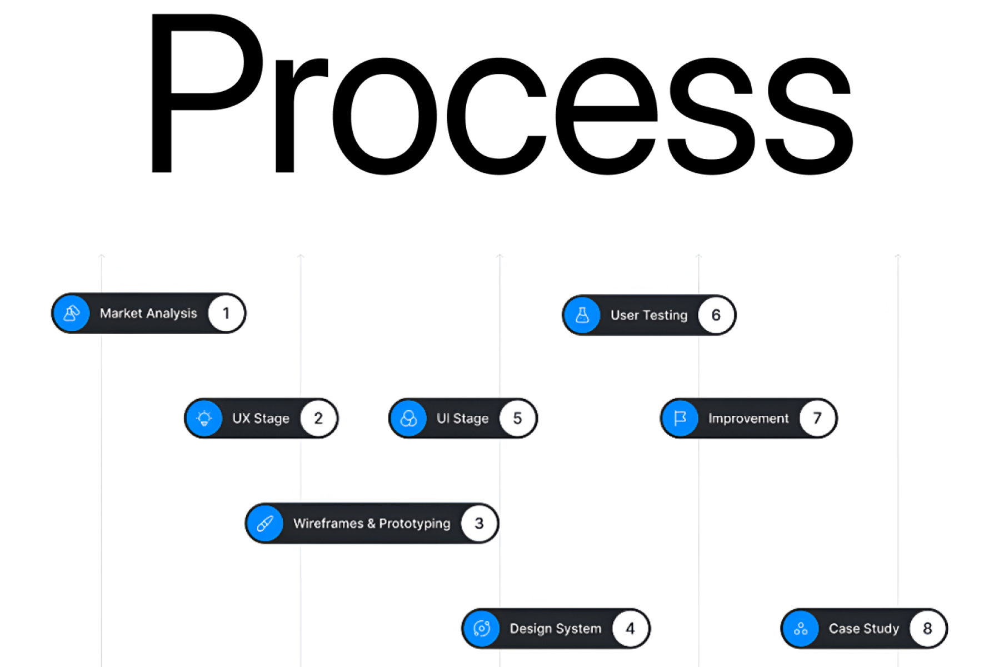

1. **Market analysis** – your goals, your users, your competitors and what isn't working today.
2. **UX stage** – user flows, information architecture and the logic behind every screen.
3. **Wireframes & prototyping** – low-fi layouts and clickable flows before any visuals.
4. **Design system** – colours, type, variables and reusable Figma components.
5. **UI stage** – high-fidelity screens built on the design system.
6. **User testing** – real users try the prototype so problems show up early.
7. **Improvement** – iterate on what testing found.
8. **Case study & handoff** – developer-ready Figma files and a documented case study.

**Tools:** Figma, FigJam, Figma prototyping, Auto Layout, variables and design tokens, Adobe Photoshop and Illustrator.

---

# Portfolio projects

**39 projects:** 8 Mobile App Design · 2 SaaS Dashboards · 13 Landing Pages & Websites · 4 App Store Screenshots · 12 Branding & Social

## Mobile App UI/UX Design (iOS & Android)

End-to-end mobile app UI/UX design for iOS and Android: user flows, wireframes, high-fidelity screens and clickable Figma prototypes.

<table>
<tr><td width="50%" valign="top"> <b><a href="projects/mobile/casino-gaming-mobile-app-ui/README.md">Casino Gaming Mobile App UI</a></b> Mobile · Gaming</td><td width="50%" valign="top"> <b><a href="projects/mobile/clinic-appointment-booking-app/README.md">Clinic Appointment Booking App – iOS &amp; Android UI/UX Design</a></b> iOS &amp; Android · Healthcare</td></tr>
<tr><td width="50%" valign="top"> <b><a href="projects/mobile/foody-food-delivery-app/README.md">Foody – Food Delivery Mobile App UI/UX Design</a></b> iOS &amp; Android · Food &amp; Delivery</td><td width="50%" valign="top"><a href="projects/mobile/movie-streaming-app/README.md">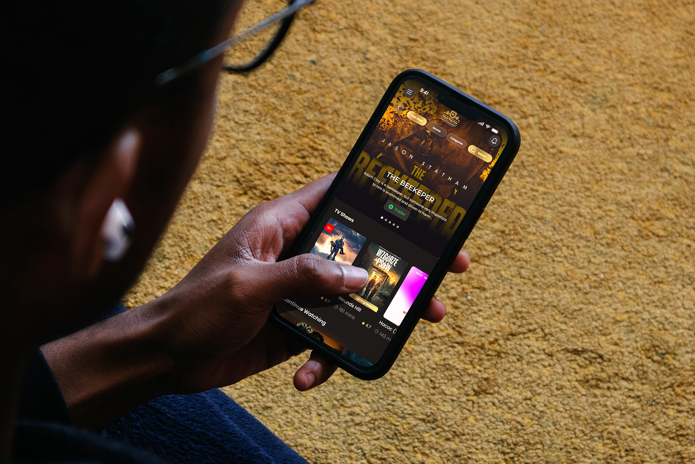</a> <b><a href="projects/mobile/movie-streaming-app/README.md">Royal Rapchee – Movie &amp; Music Streaming App UI/UX Design</a></b> iOS &amp; Android · Media / Streaming</td></tr>
<tr><td width="50%" valign="top"> <b><a href="projects/mobile/pedometer-app-onboarding-redesign/README.md">MistyWay – Pedometer App Onboarding Screens Redesign | UI/UX Design</a></b> iOS &amp; Android · Health &amp; Fitness / Gamified walking</td><td width="50%" valign="top"> <b><a href="projects/mobile/real-estate-mobile-app-hously/README.md">Real Estate Mobile App UI/UX Design – Property Rental &amp; Search</a></b> iOS &amp; Android · Real estate / Property rental</td></tr>
<tr><td width="50%" valign="top"> <b><a href="projects/mobile/ride-booking-mobile-app/README.md">Chooze – Ride Booking Mobile App UI/UX Design</a></b> iOS &amp; Android · Mobility / Ride hailing</td><td width="50%" valign="top"> <b><a href="projects/mobile/smart-home-mobile-app/README.md">Homify – Smart Home Mobile App UI/UX Design</a></b> iOS &amp; Android · IoT / Smart home</td></tr>
</table>

## SaaS Dashboard & Web App Design

SaaS dashboard design, admin panels and web app UI that make dense data easy to read and act on.

<table>
<tr><td width="50%" valign="top"><a href="projects/dashboard/noum-dental-dashboard/README.md">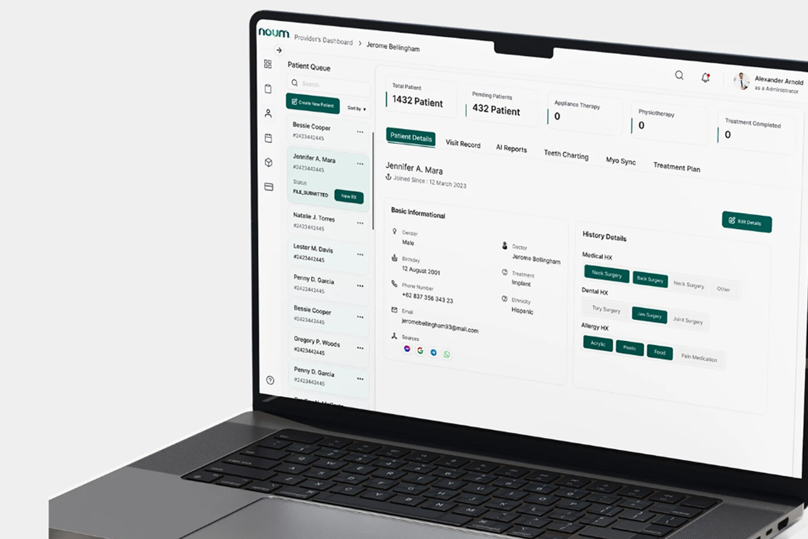</a> <b><a href="projects/dashboard/noum-dental-dashboard/README.md">Noum – Dental Clinic Provider Dashboard UI/UX Design (HealthTech SaaS)</a></b> Web App · Healthcare / Dental</td><td width="50%" valign="top"> <b><a href="projects/dashboard/saas-finance-dashboard/README.md">FinLab – SaaS Finance Dashboard UI/UX Design</a></b> Web App · Fintech</td></tr>
</table>

## Landing Page & Website Design

Conversion-focused landing page design and responsive website UI/UX for SaaS, fintech, EdTech, healthcare and agencies.

<table>
<tr><td width="50%" valign="top"><a href="projects/web/academic-website-ui-ux/README.md">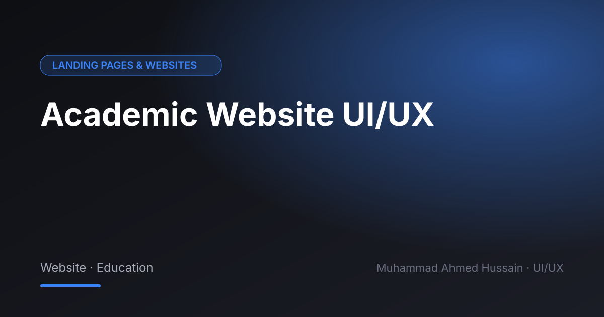</a> <b><a href="projects/web/academic-website-ui-ux/README.md">Academic Website UI/UX</a></b> Website · Education</td><td width="50%" valign="top"><a href="projects/web/ai-learning-platform-web-app/README.md">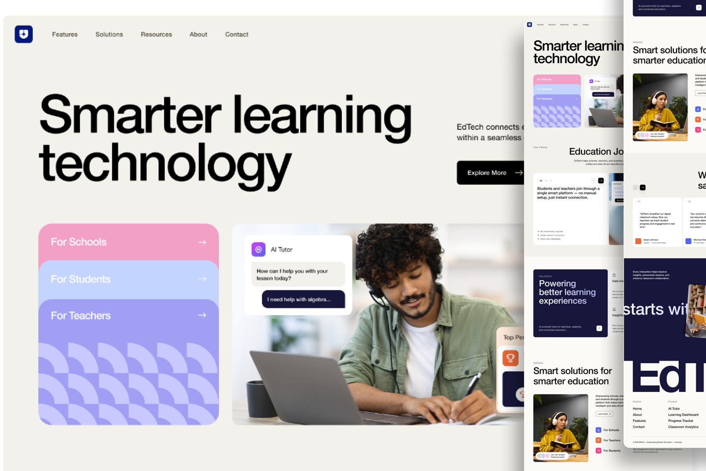</a> <b><a href="projects/web/ai-learning-platform-web-app/README.md">AI Learning Platform Web App – EdTech UI/UX Design</a></b> EdTech</td></tr>
<tr><td width="50%" valign="top"> <b><a href="projects/web/animation-brand-landing-page/README.md">Animation Studio – Brand Landing Page UI/UX Design</a></b> Animation / Video production</td><td width="50%" valign="top"> <b><a href="projects/web/beryl-financials-fintech-landing-page/README.md">Beryl Financials – Fintech Landing Page UI/UX Design</a></b> Fintech / Financial services</td></tr>
<tr><td width="50%" valign="top"><a href="projects/web/elite-bond-website/README.md">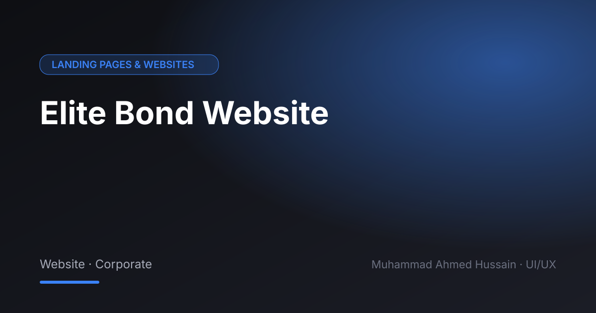</a> <b><a href="projects/web/elite-bond-website/README.md">Elite Bond Website</a></b> Website · Corporate</td><td width="50%" valign="top"><a href="projects/web/flight-booking-landing-page/README.md">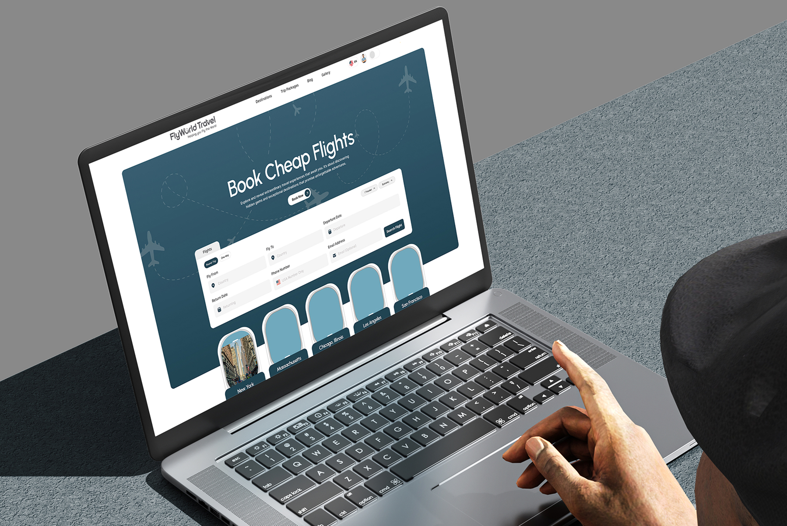</a> <b><a href="projects/web/flight-booking-landing-page/README.md">FlyWorld Travel – Flight Booking Website &amp; Landing Page Design</a></b> Travel / Flight booking</td></tr>
<tr><td width="50%" valign="top"> <b><a href="projects/web/healthcare-landing-page/README.md">Healthcare Landing Page</a></b> Landing Page · Healthcare</td><td width="50%" valign="top"><a href="projects/web/jerseycode-systems-landing-page/README.md">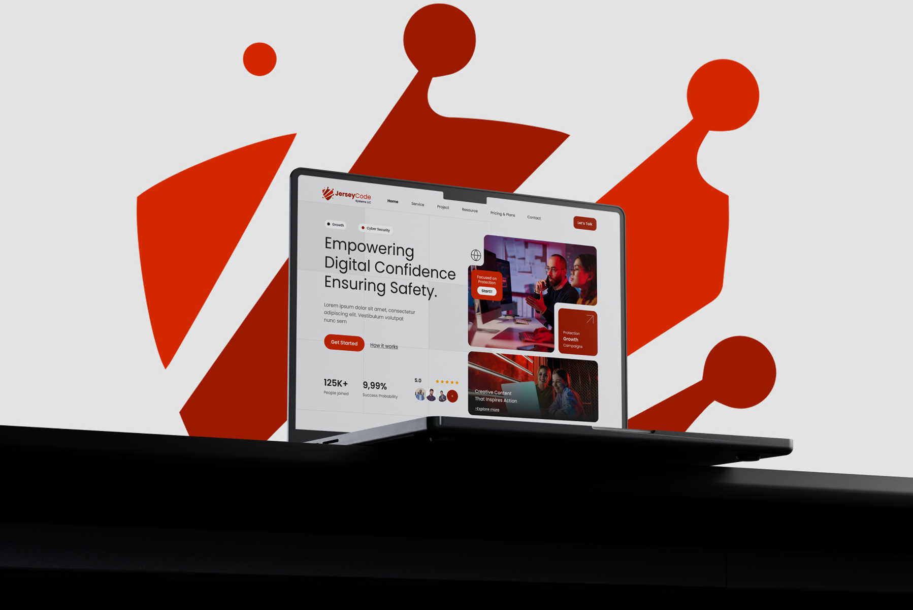</a> <b><a href="projects/web/jerseycode-systems-landing-page/README.md">JerseyCode Systems – Cybersecurity Company Website &amp; Landing Page Design</a></b> Cybersecurity / IT services</td></tr>
<tr><td width="50%" valign="top"><a href="projects/web/kitchen-gadgets-website/README.md">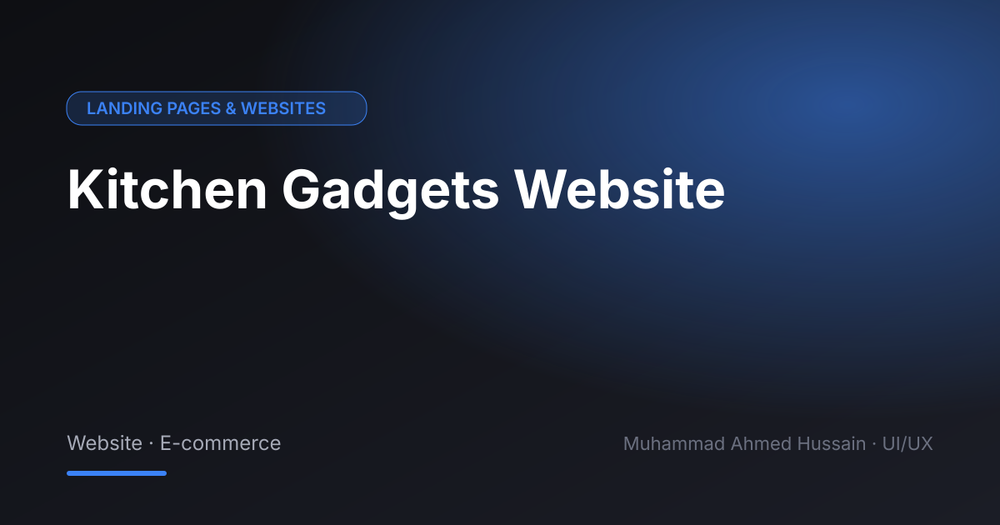</a> <b><a href="projects/web/kitchen-gadgets-website/README.md">Kitchen Gadgets Website</a></b> Website · E-commerce</td><td width="50%" valign="top"> <b><a href="projects/web/ovitech-pvt-ltd-website-ui-ux/README.md">OviTech (Pvt) Ltd – Website UI/UX</a></b> Website · IT Company</td></tr>
<tr><td width="50%" valign="top"> <b><a href="projects/web/pixlency-animation-landing-page/README.md">Pixlency Animation – Landing Page</a></b> Website · Creative Agency</td><td width="50%" valign="top"><a href="projects/web/radium-website-ui-ux/README.md">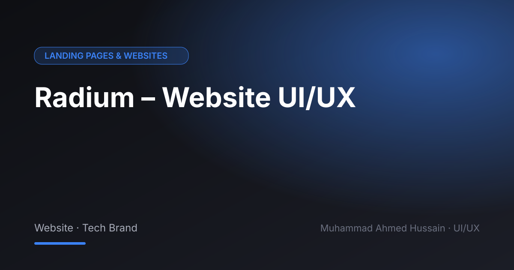</a> <b><a href="projects/web/radium-website-ui-ux/README.md">Radium – Website UI/UX</a></b> Website · Tech Brand</td></tr>
<tr><td width="50%" valign="top"> <b><a href="projects/web/viral-marketing-website/README.md">Viral Marketing Website</a></b> Website · Marketing Agency</td><td width="50%"></td></tr>
</table>

## App Store Screenshot Design (ASO)

App Store and Google Play screenshot design for iPhone and iPad that improves conversion from store page to install.

<table>
<tr><td width="50%" valign="top"> <b><a href="projects/appstore/app-store-screenshot-a-b-test-variations/README.md">App Store Screenshot A/B Test Variations</a></b> iOS · ASO</td><td width="50%" valign="top"><a href="projects/appstore/app-store-screenshots-pickradar-wordipo/README.md">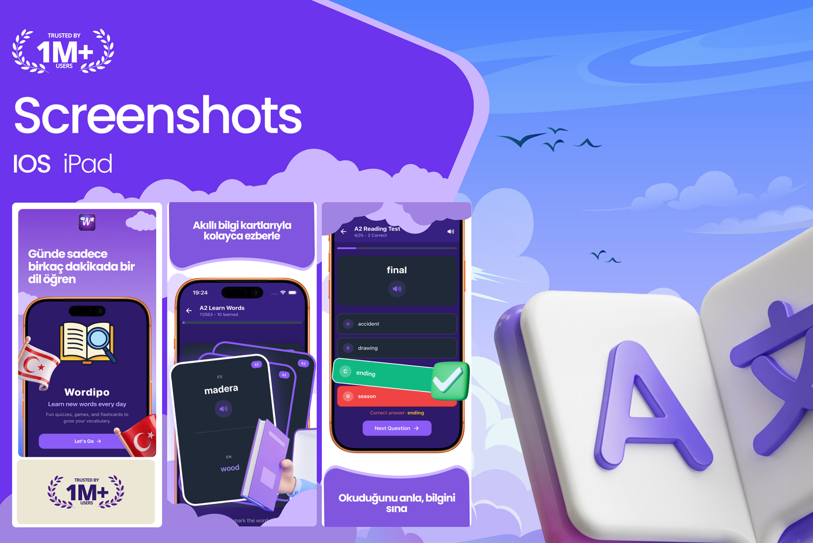</a> <b><a href="projects/appstore/app-store-screenshots-pickradar-wordipo/README.md">App Store Screenshots – PickRadar &amp; Wordipo | iOS &amp; iPad ASO</a></b> iOS &amp; iPad</td></tr>
<tr><td width="50%" valign="top"> <b><a href="projects/appstore/fantasy-walking-pedometer-app-screenshots/README.md">MistyWay – Fantasy Walking Pedometer App Store Screenshots | ASO</a></b> iOS &amp; iPad · Health &amp; Fitness / Gamified walking</td><td width="50%" valign="top"><a href="projects/appstore/finance-app-store-screenshots/README.md">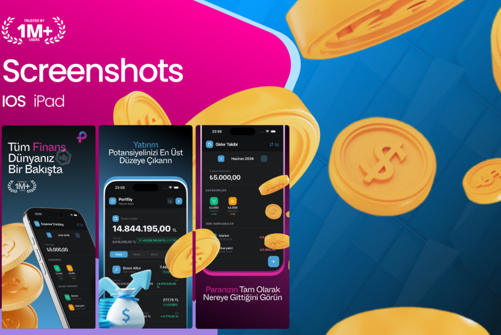</a> <b><a href="projects/appstore/finance-app-store-screenshots/README.md">Finance App Store Screenshots – iOS &amp; iPad | ASO</a></b> iOS &amp; iPad</td></tr>
</table>

## Branding, Logo & Social Media Design

Brand identity, logo design and social media creatives that keep a product's look consistent everywhere.

<table>
<tr><td width="50%" valign="top"><a href="projects/brand/book-publishing-social-media-design/README.md">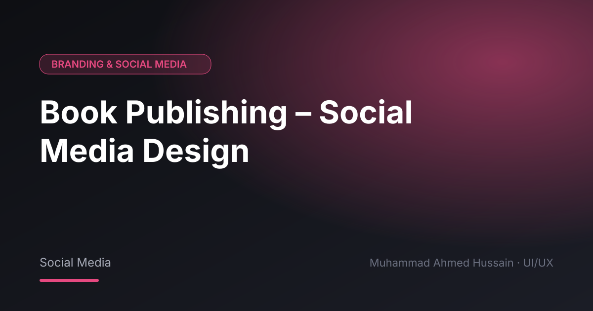</a> <b><a href="projects/brand/book-publishing-social-media-design/README.md">Book Publishing – Social Media Design</a></b> Social Media</td><td width="50%" valign="top"> <b><a href="projects/brand/dvyn-solutions-branding/README.md">Dvyn Solutions – Branding</a></b> Brand Identity</td></tr>
<tr><td width="50%" valign="top"><a href="projects/brand/dyvn-logo-branding/README.md">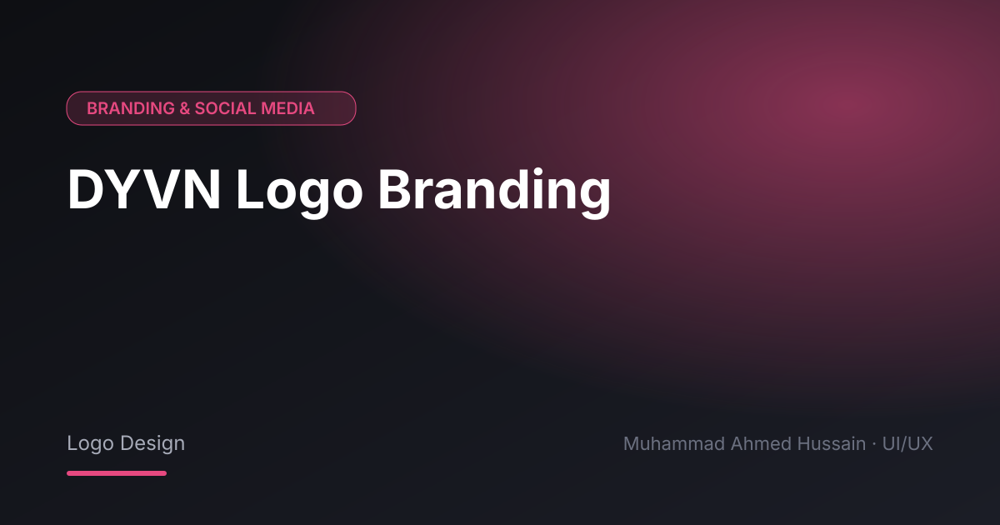</a> <b><a href="projects/brand/dyvn-logo-branding/README.md">DYVN Logo Branding</a></b> Logo Design</td><td width="50%" valign="top"> <b><a href="projects/brand/expert-texting-social-media/README.md">Expert Texting – Social Media</a></b> Social Media</td></tr>
<tr><td width="50%" valign="top"><a href="projects/brand/jaguar-logo-re-branding/README.md">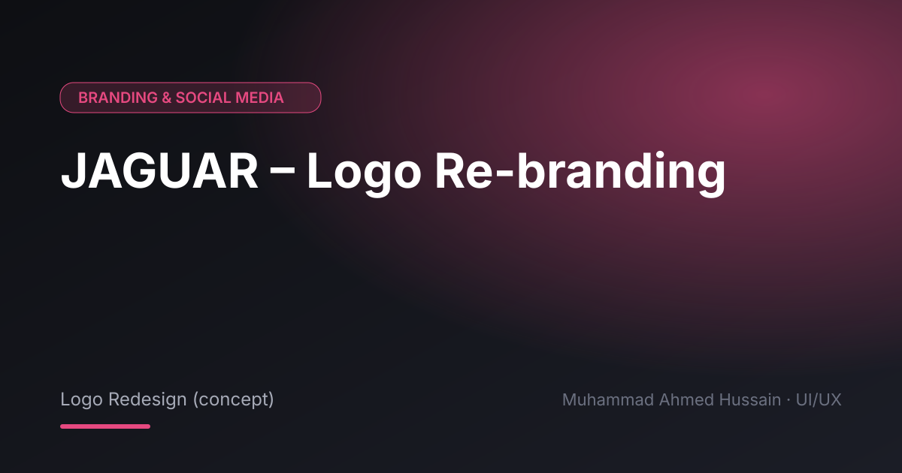</a> <b><a href="projects/brand/jaguar-logo-re-branding/README.md">JAGUAR – Logo Re-branding</a></b> Logo Redesign (concept)</td><td width="50%" valign="top"> <b><a href="projects/brand/pixlency-social-media/README.md">Pixlency – Social Media</a></b> Social Media</td></tr>
<tr><td width="50%" valign="top"> <b><a href="projects/brand/radium-branding/README.md">Radium – Branding</a></b> Brand Identity</td><td width="50%" valign="top"><a href="projects/brand/reliance-dev-social-media-creative/README.md">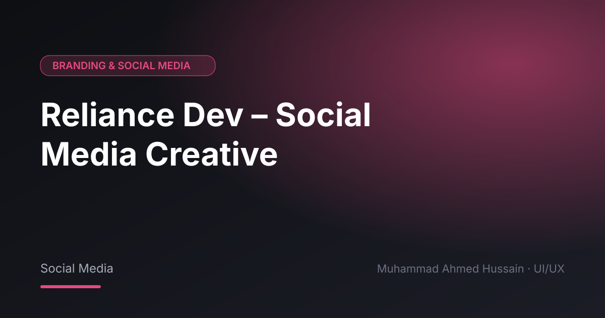</a> <b><a href="projects/brand/reliance-dev-social-media-creative/README.md">Reliance Dev – Social Media Creative</a></b> Social Media</td></tr>
<tr><td width="50%" valign="top"> <b><a href="projects/brand/reliance-tech-social-media-design/README.md">Reliance Tech – Social Media Design</a></b> Social Media</td><td width="50%" valign="top"><a href="projects/brand/seo-entire-social-media/README.md">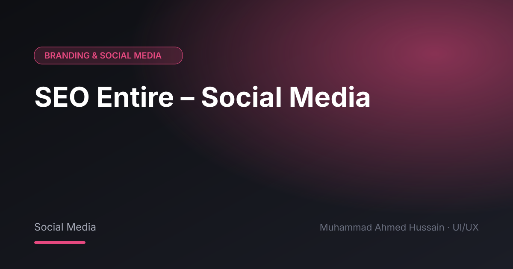</a> <b><a href="projects/brand/seo-entire-social-media/README.md">SEO Entire – Social Media</a></b> Social Media</td></tr>
<tr><td width="50%" valign="top"> <b><a href="projects/brand/signature-logos-brand-identity-campaign/README.md">Signature Logos – Brand Identity Campaign</a></b> Brand Campaign</td><td width="50%" valign="top"><a href="projects/brand/social-media-post-design-visual-storytelling/README.md">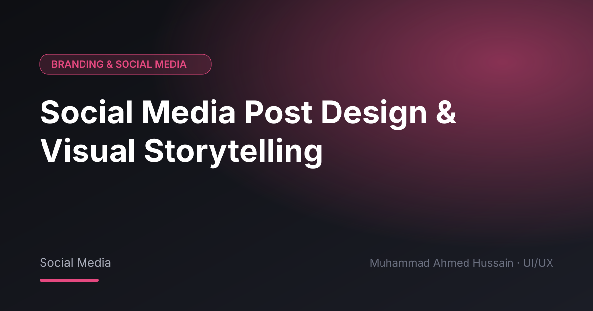</a> <b><a href="projects/brand/social-media-post-design-visual-storytelling/README.md">Social Media Post Design &amp; Visual Storytelling</a></b> Social Media</td></tr>
</table>

---

## Experience

- **UI/UX Designer** – Pixlency
- **UI/UX Designer** – Software One
- **Senior Creative Designer** – OviTech (Pvt) Ltd
- **Creative Specialist** – Affect Agency (Türkiye)

**Education:** BS Digital Forensics & Cyber Security, Hamdard University

## Hire a UI/UX designer

Looking for a **freelance UI/UX designer** for your mobile app, SaaS product or website? Send me the one screen that bothers you most, and I'll tell you what I'd fix first.

**[Hire me on Upwork](https://www.upwork.com/freelancers/~01a964112574c69119)** · **[View portfolio website](https://ahmedh-productdesigner.github.io/ui-ux-portfolio/)**

Keywords: UI/UX designer, UI UX design portfolio, freelance UI/UX designer, Figma designer, mobile app designer, mobile app UI/UX design, SaaS dashboard design, dashboard UI, landing page design, website redesign, web design, user interface design, UX design, product design, design system, wireframing, prototyping, user flow, UX case study, App Store screenshots, ASO, UI/UX designer Pakistan, UI/UX designer Karachi.

© Muhammad Ahmed Hussain. Designs are shown for portfolio purposes; client work belongs to the respective owners.
