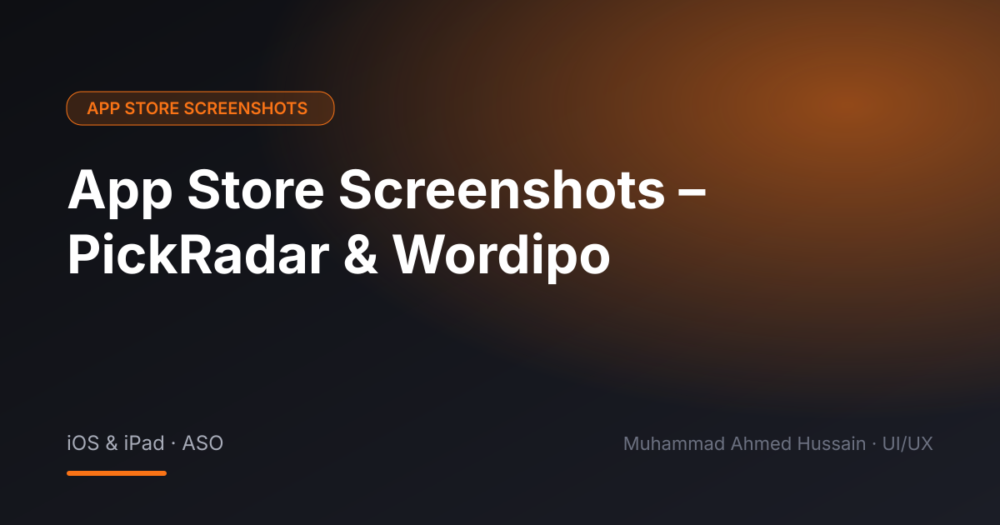

# App Store Screenshots – PickRadar & Wordipo

**Category:** App Store Screenshots · **Type:** iOS & iPad · ASO · **Tool:** Figma

App Store screenshot sets for PickRadar, a sports prediction app, and Wordipo, a language learning platform.

## The challenge

Most users decide from the first two or three screenshots. Each set had to tell the app's story at a glance.

## What I designed

- iPhone screenshot set
- iPad screenshot set
- Headline copy and feature callouts
- Export sizes for App Store Connect

## Approach

One clear benefit per screenshot, bold headlines and device frames that keep the UI readable in search results.

## Screens

<!-- Add exported screens to the images/ folder, then list them here, e.g.  -->
_Screens are in the [`images`](images/) folder._

## Figma file

[Open the design in Figma](https://www.figma.com/design/mOq83Zs1EU9sSx2JPU35gc/PickRadar-x-Wordipo)

## Process

Discovery → wireframes and user flows → high-fidelity UI with a component library → clickable prototype → developer-ready handoff.

---

[← Back to all projects](../../../README.md) · [Hire me on Upwork](https://www.upwork.com/freelancers/~01a964112574c69119)
