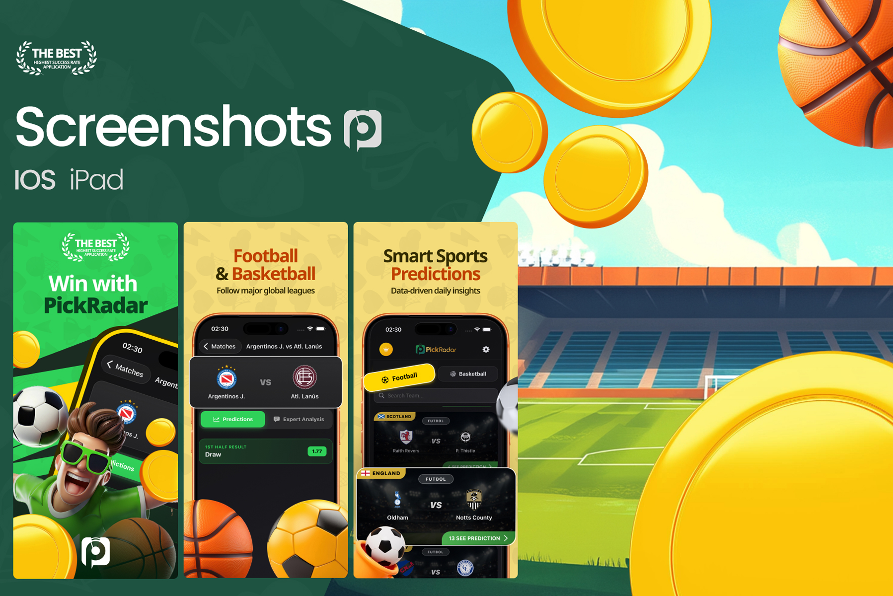
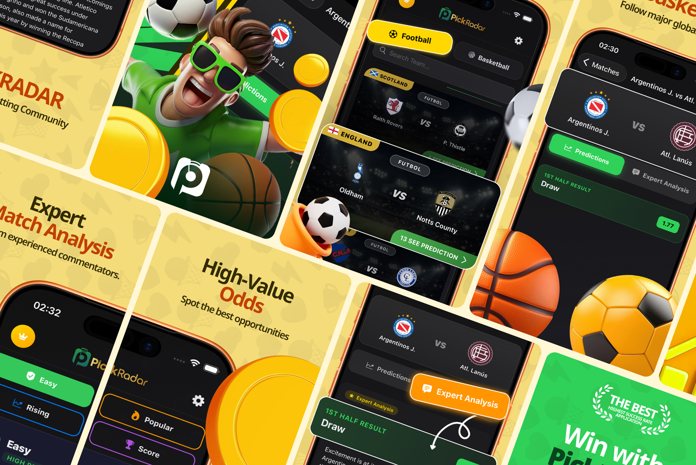
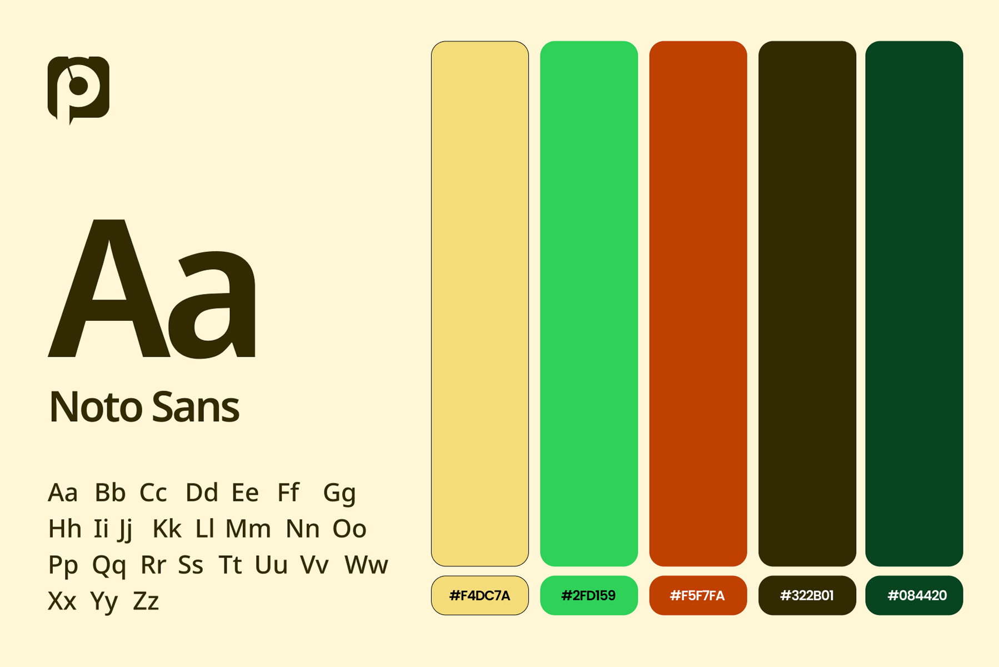
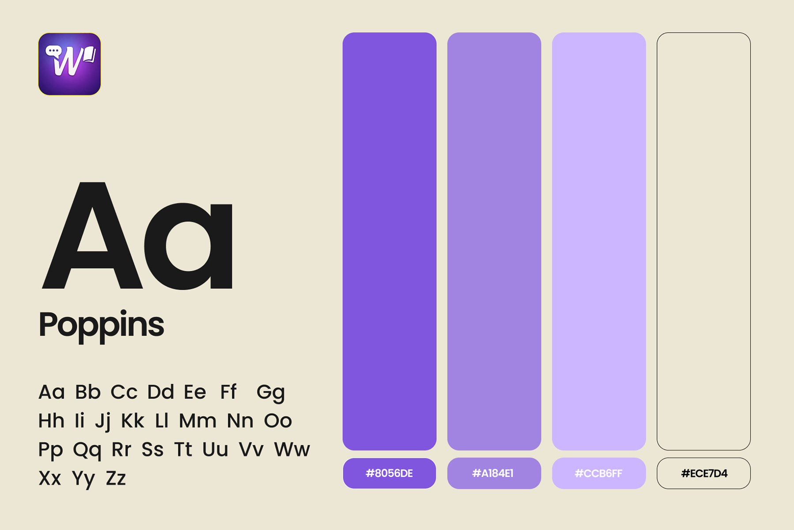

# App Store Screenshots – PickRadar & Wordipo | iOS & iPad ASO

**Category:** App Store Screenshots · **Platform:** iOS & iPad · **Tool:** Figma

Two App Store screenshot projects for two very different apps: **PickRadar**, a sports prediction app, and **Wordipo**, a language learning app. Each one needed its own visual world, but the goal was the same: tell the app's story in the first three screenshots and turn browsers into installs.

---

## PickRadar – Sports Prediction App

PickRadar gives football and basketball fans data-driven match predictions and expert analysis.

### What I designed

- **"Win with PickRadar":** the hero frame with a 3D football fan character, flying coins and a "The Best – Highest Success Rate Application" badge
- **"Football & Basketball – Follow major global leagues":** the match detail screen (Argentinos J. vs Atl. Lanús) with *Predictions* and *Expert Analysis* tabs
- **"Smart Sports Predictions – Data-driven daily insights":** the match list with league tags (Scotland, England) and *See Prediction* buttons
- **Extra frames:** *Expert Match Analysis* ("from experienced commentators"), *High-Value Odds* ("Spot the best opportunities") and prediction categories (Easy, Rising, Popular, Score)

### Brand style

- **Type:** Noto Sans
- **Colour:** sunny yellow `#F4DC7A`, pitch green `#2FD159`, burnt orange, deep olive `#322B01` and forest green `#084420`
- **Look:** stadium scenes, 3D balls and gold coins for a high-energy, game-day feel

---

## Wordipo – Language Learning App

Wordipo helps Turkish speakers learn new words with flashcards, quizzes and reading tests.

### What I designed

- **"Günde sadece birkaç dakikada bir dil öğren"** (*Learn a language in just a few minutes a day*): the hero frame with the Wordipo welcome screen and a "Trusted by 1M+ users" badge
- **"Akıllı bilgi kartlarıyla kolayca ezberle"** (*Memorise easily with smart flashcards*): the A2 flashcard screen (madera → wood)
- **"Okuduğunu anla, bilgini sına"** (*Understand what you read, test your knowledge*): the A2 reading test with a correct-answer state

### Brand style

- **Type:** Poppins
- **Colour:** violet `#8056DE`, lavender `#A184E1`, soft lilac `#CCB6FF` and warm cream `#ECE7D4`
- **Look:** a dreamy sky with clouds and 3D letter blocks, calm and friendly for daily learning

---

## Approach

- **A distinct world for each app.** Bold, sporty and loud for PickRadar; soft, airy and encouraging for Wordipo.
- **One message per frame**, with short headlines that still read at thumbnail size.
- **Trust badges on frame one**, where the install decision happens.
- **Real UI inside device frames**, so users see the actual product before downloading.
- **Delivered for iPhone and iPad** in App Store Connect sizes.

**Tags:** App Store Screenshots · App Store Optimization (ASO) · iOS Screenshots · iPad Screenshots · Google Play Screenshots · A/B Testing · Figma · UI/UX Designer

---

[← Back to all projects](../../../README.md) · [Hire this UI/UX designer on Upwork](https://www.upwork.com/freelancers/~01a964112574c69119)
