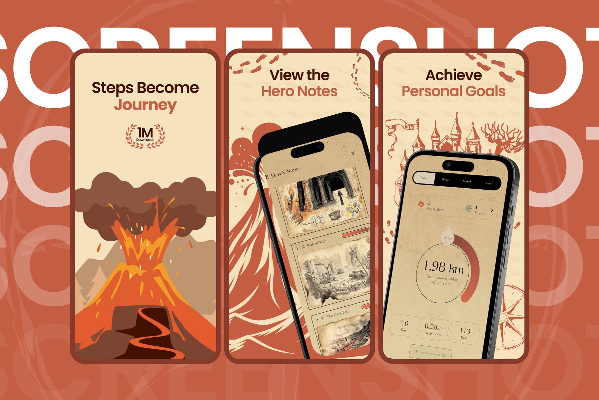
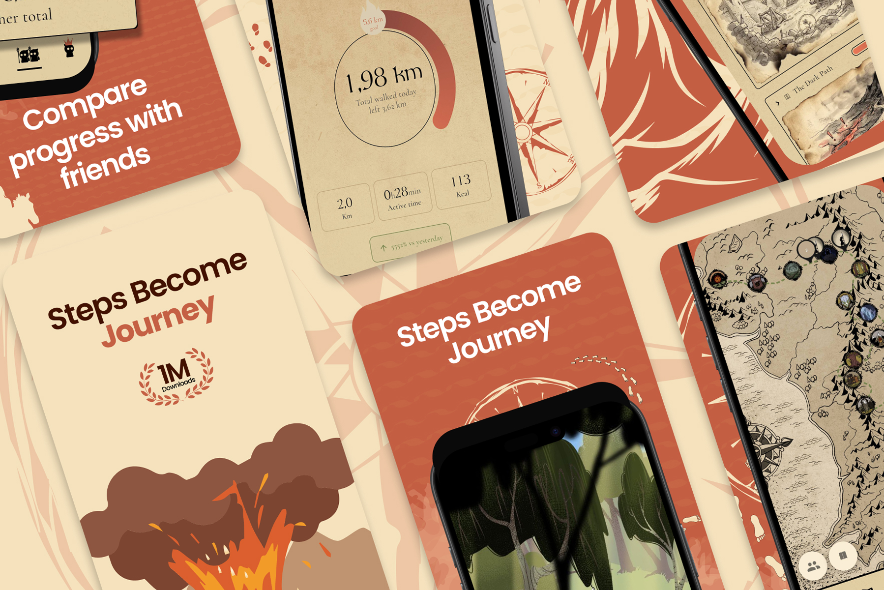
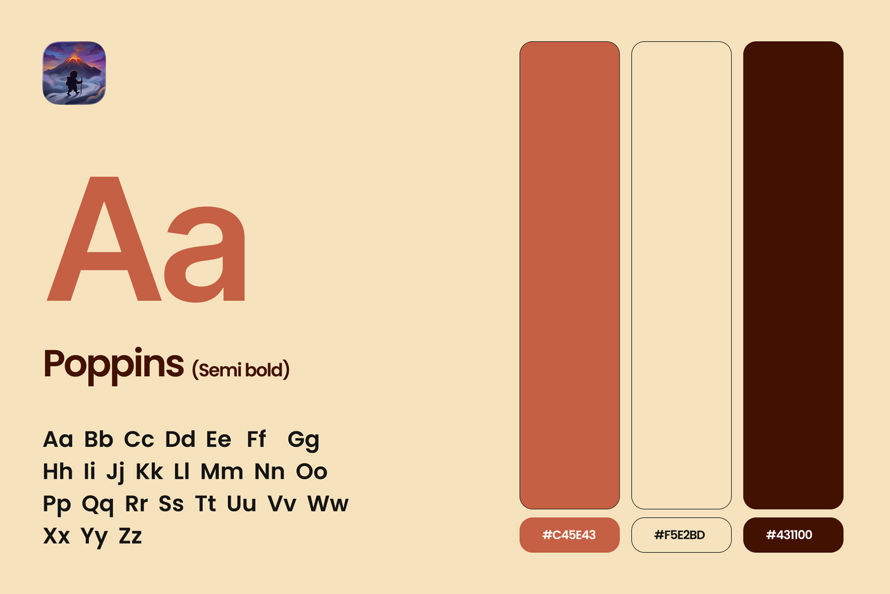

# MistyWay – Fantasy Walking Pedometer App Store Screenshots | ASO

**Category:** App Store Screenshots · **Platform:** iOS & iPad · **Industry:** Health & Fitness / Gamified walking · **Tool:** Figma

App Store screenshots for MistyWay, a fantasy adventure pedometer where real-world steps move your hero through an epic map. The screenshots had to sell the fun, not just "another step counter", in the first three swipes.

## The challenge

The step-counter category is crowded with near-identical rings and graphs. MistyWay's difference is the story: volcanoes, castles, hero notes and a journey. The screenshot set needed to make that adventure obvious at thumbnail size while still showing that it's a real, useful fitness tracker.

## What I designed

1. **"Steps Become Journey":** the hero frame with a bold illustrated volcano and a "1M Downloads" badge
2. **"View the Hero Notes":** the Hero's Notes journal with illustrated chapters (Path of War, The Dark Path) that unlock as you walk
3. **"Achieve Personal Goals":** the daily tracker (1.98 km walked today, distance left, streak days, freeze, km, active time and kcal) with Today / Week / Month / Total tabs
4. **"Compare progress with friends":** the social leaderboard frame
5. **Alternate light and terracotta versions**, plus a map frame showing the journey route, for testing and variety

## Visual style

- **Type:** Poppins SemiBold for headlines, readable at App Store thumbnail size
- **Colour:** terracotta `#C45E43`, parchment `#F5E2BD` and deep brown `#431100`
- **Look:** flat, warm fantasy illustrations (volcano, castles, footprints, compass) that tie into the in-app parchment style

## Approach

- **Lead with the story, back it up with data.** Frame one sells the adventure, and frame three proves it's a serious tracker.
- **Two-tone headlines**, with the key word in terracotta (Journey, Hero Notes, Personal Goals).
- **Social proof on frame one**, where most install decisions happen.
- **Consistent with the product.** Colours and illustrations match the onboarding, so there's no gap between the store and the app.
- **Delivered for iPhone and iPad** in App Store Connect sizes.

**Tags:** App Store Screenshots · App Store Optimization (ASO) · iOS Screenshots · iPad Screenshots · Google Play Screenshots · A/B Testing · Figma · UI/UX Designer

---

[← Back to all projects](../../../README.md) · [Hire this UI/UX designer on Upwork](https://www.upwork.com/freelancers/~01a964112574c69119)
