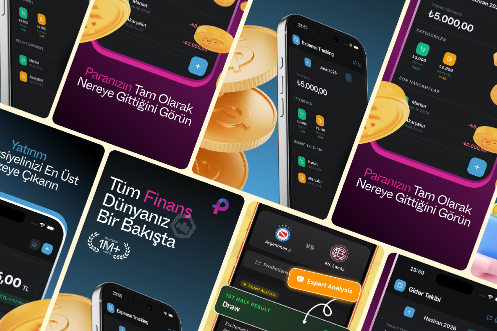

# Finance App Store Screenshots – iOS & iPad | ASO

**Category:** App Store Screenshots · **Platform:** iOS & iPad · **Market:** Turkey (Turkish language) · **Tool:** Figma

App Store screenshots for a Turkish personal finance app that brings expense tracking and investment portfolios together. The set has to grab attention in search results and explain the app's three main jobs in three swipes.

## The challenge

Finance apps all look alike in the App Store: dark screens, lots of numbers. These screenshots needed to stand out, feel trustworthy and get across the core value (everything about your money in one place) fast, in Turkish, for a local audience.

## What I designed

A story told across the screenshot set, one benefit per frame:

1. **"Tüm Finans Dünyanız Bir Bakışta"** (*Your whole financial world at a glance*): the hero frame with the app logo, a "Trusted by 1M+ users" badge and the expense tracking screen
2. **"Yatırım Potansiyelinizi En Üst Düzeye Çıkarın"** (*Maximise your investment potential*): the Portföy (portfolio) screen showing total value, gains and assets like gram gold
3. **"Paranızın Tam Olarak Nereye Gittiğini Görün"** (*See exactly where your money goes*): Gider Takibi (expense tracking) with monthly totals, categories (market, fuel) and recent spending

Delivered for **iPhone and iPad** at App Store Connect sizes.

## Visual style

- **Magenta-to-blue gradient backgrounds** that stand out from the usual green and navy finance apps
- **3D gold coins and money-bag illustrations** that break out of the frames for depth and energy
- **Bold two-tone headlines**, with the key word highlighted in pink or blue
- **Real app UI** in device frames, kept large enough to read at App Store thumbnail size

## Approach

- **One benefit per screenshot.** Overview → investing → spending.
- **Social proof up front.** The 1M+ users badge is on the first frame, where most installs are decided.
- **Localised copy.** Headlines are written natively in Turkish for the target market.
- **Continuous background.** Coins and gradients flow across frames, so the set reads as one panorama when swiped.

**Tags:** App Store Screenshots · App Store Optimization (ASO) · iOS Screenshots · iPad Screenshots · Google Play Screenshots · A/B Testing · Figma · UI/UX Designer

---

[← Back to all projects](../../../README.md) · [Hire this UI/UX designer on Upwork](https://www.upwork.com/freelancers/~01a964112574c69119)
