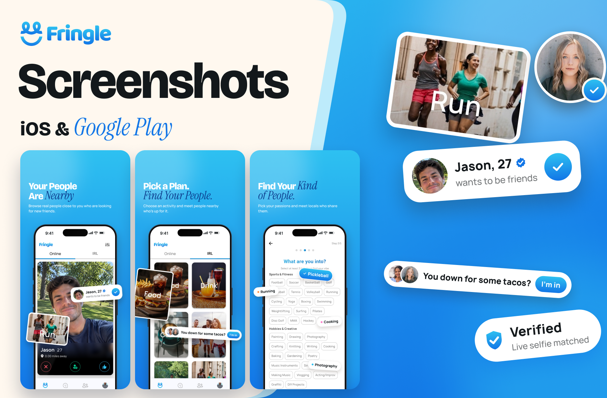
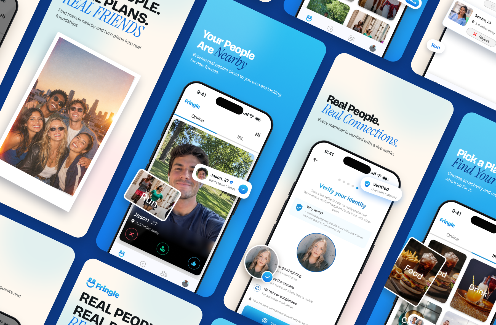
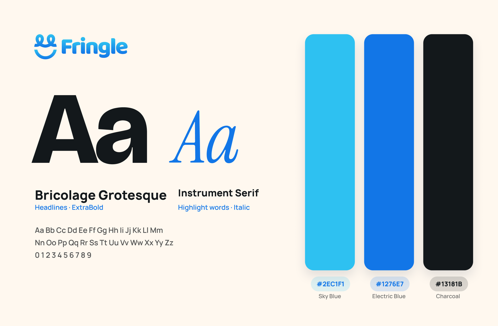

# Fringle – Friendship App Store & Google Play Screenshots | ASO

**Category:** App Store Screenshots · **Platform:** iOS & Google Play · **Industry:** Social / Friendship app · **Tool:** Figma

App Store and Google Play screenshots for Fringle, a friendship app for adults who want real friends, not dates. The founder needed a set that makes that clear at a glance and gets people to download.

## The challenge

Most apps that show two smiling strangers on a phone read as dating apps. Fringle had to look warm and social without anything romantic in the visuals or the copy, and the first few screens had to explain the app on their own.

## What I designed

Seven screenshots, each delivered for iPhone 6.9" (1320 × 2868), iPhone 6.5" (1284 × 2778) and Google Play (1080 × 1920, with an Android device frame):

1. **"Real People. Real Plans. Real Friends":** a hero with a rooftop photo of a friend group, so the first frame says friendship, not dating
2. **"Your People Are Nearby":** the home screen with Jason's friend request and the Run activity tile floating off the phone
3. **"Real People. Real Connections.":** live selfie verification with a Verified pill
4. **"Pick a Plan. Find Your People.":** the IRL activities grid with a "You down for some tacos?" invite
5. **"Invite. Accept. Hang Out.":** friend requests and in-person invites, with Food, Hang Out, Explore and Run tags
6. **"Find Your Kind of People.":** the interests picker
7. **"Start With a Hello":** adding a personal note to a request

Headlines and subtitles came from the founder's copy document.

## Three directions

- **A, all blue:** every frame on the blue gradient, with key words in dark blue
- **B, alternating:** hero, then blue and cream frames in turn. **The client picked this one.**
- **C, 90s film:** version B with light film grain, warm light leaks and a date stamp

## Visual style

- **Type:** Bricolage Grotesque ExtraBold for headlines, Instrument Serif Italic for the highlight word in each one
- **Colour:** Sky Blue `#2EC1F1`, Electric Blue `#1276E7`, Cream `#FFF8EF` and Charcoal `#13181B`, all from Fringle's brand palette
- **Look:** real app screens in device frames, with key UI pieces (requests, invites, tags) pulled out as floating cards so the feature reads at thumbnail size

## Approach

- **Say "friends" before anything else.** The hero leads with a group photo and the word "Friends" so nobody mistakes Fringle for a dating app.
- **Make each frame readable on its own.** One headline, one feature, one floating detail.
- **Alternate backgrounds** so the set doesn't blur together as people swipe.
- **Store ready.** Every PNG is exported without an alpha channel, so App Store Connect accepts it without errors.
- **Extras for social:** matching blue, cream and cream to blue gradient backgrounds in Instagram Story, Post and Square sizes.

**Tags:** App Store Screenshots · App Store Optimization (ASO) · iOS Screenshots · Google Play Screenshots · Social App · Friendship App · Figma · UI/UX Designer

---

[← Back to all projects](../../../README.md) · [Hire this UI/UX designer on Upwork](https://www.upwork.com/freelancers/~01a964112574c69119)
