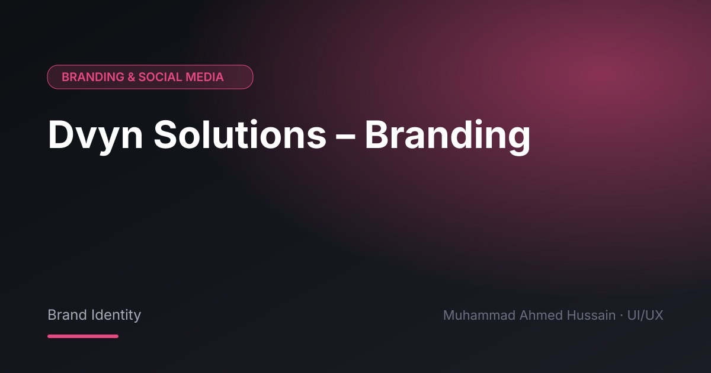

# Dvyn Solutions – Branding

**Category:** Branding & Social Media · **Type:** Brand Identity · **Tool:** Figma

Brand identity for Dvyn Solutions, covering logo, colours and brand applications.

## The challenge

A young company needed an identity that looks established and works across digital and print.

## What I designed

- Logo design
- Colour palette and typography
- Brand applications

## Approach

Simple, scalable marks that work small and large.

## Screens

<!-- Add exported screens to the images/ folder, then list them here, e.g.  -->
_Screens are in the [`images`](images/) folder._

## Process

Discovery → wireframes and user flows → high-fidelity UI with a component library → clickable prototype → developer-ready handoff.

---

[← Back to all projects](../../../README.md) · [Hire me on Upwork](https://www.upwork.com/freelancers/~01a964112574c69119)
