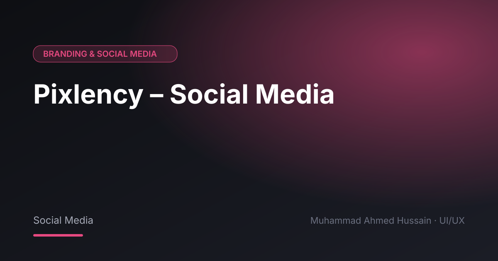

# Pixlency – Social Media

**Category:** Branding & Social Media · **Type:** Social Media · **Tool:** Figma

Social media content for Pixlency, an animation and creative studio.

## The challenge

A creative studio's feed is its shop window.

## What I designed

- Post designs
- Promotional creatives
- Story formats

## Approach

Playful, colourful visuals that match the studio's work.

## Screens

<!-- Add exported screens to the images/ folder, then list them here, e.g.  -->
_Screens are in the [`images`](images/) folder._

## Process

Discovery → wireframes and user flows → high-fidelity UI with a component library → clickable prototype → developer-ready handoff.

---

[← Back to all projects](../../../README.md) · [Hire me on Upwork](https://www.upwork.com/freelancers/~01a964112574c69119)
