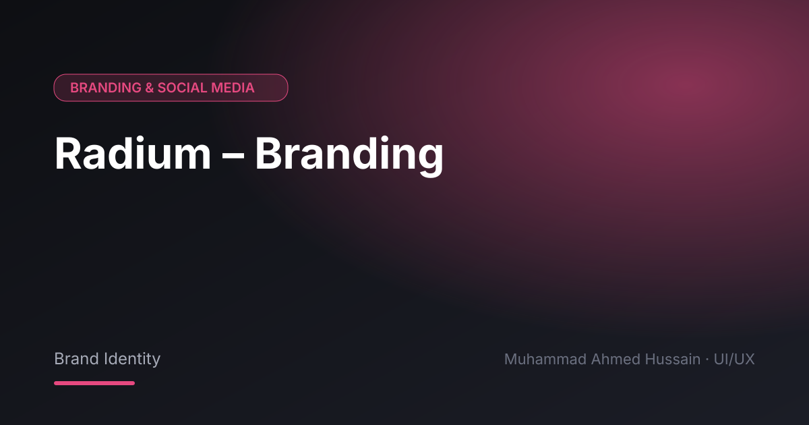

# Radium – Branding

**Category:** Branding & Social Media · **Type:** Brand Identity · **Tool:** Figma

Brand identity for Radium, later carried into the Radium website design.

## The challenge

The brand had to feel modern and technical.

## What I designed

- Logo
- Colour and type system
- Brand applications

## Approach

Built the identity as a system so it could extend to the web.

## Screens

<!-- Add exported screens to the images/ folder, then list them here, e.g.  -->
_Screens are in the [`images`](images/) folder._

## Process

Discovery → wireframes and user flows → high-fidelity UI with a component library → clickable prototype → developer-ready handoff.

**Tags:** Brand Identity · Logo Design · Social Media Design · Visual Design · Graphic Design · Figma · UI/UX Designer

---

[← Back to all projects](../../../README.md) · [Hire this UI/UX designer on Upwork](https://www.upwork.com/freelancers/~01a964112574c69119)
