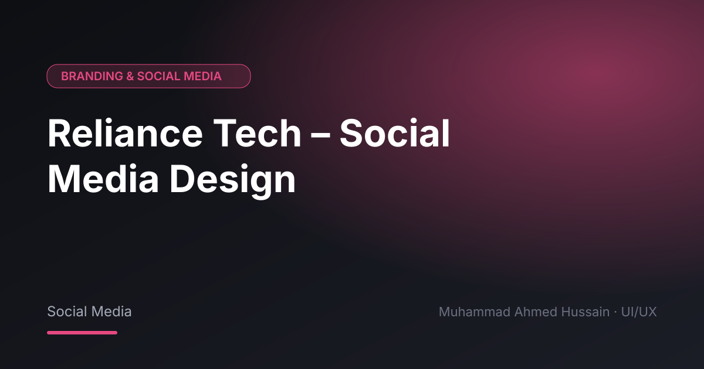

# Reliance Tech – Social Media Design

**Category:** Branding & Social Media · **Type:** Social Media · **Tool:** Figma

Social media designs for Reliance Tech.

## The challenge

The brand needed a consistent, recognisable feed.

## What I designed

- Post designs
- Campaign creatives
- Templates

## Approach

Brand colours and a repeatable grid for a consistent feed.

## Screens

<!-- Add exported screens to the images/ folder, then list them here, e.g.  -->
_Screens are in the [`images`](images/) folder._

## Process

Discovery → wireframes and user flows → high-fidelity UI with a component library → clickable prototype → developer-ready handoff.

**Tags:** Brand Identity · Logo Design · Social Media Design · Visual Design · Graphic Design · Figma · UI/UX Designer

---

[← Back to all projects](../../../README.md) · [Hire this UI/UX designer on Upwork](https://www.upwork.com/freelancers/~01a964112574c69119)
