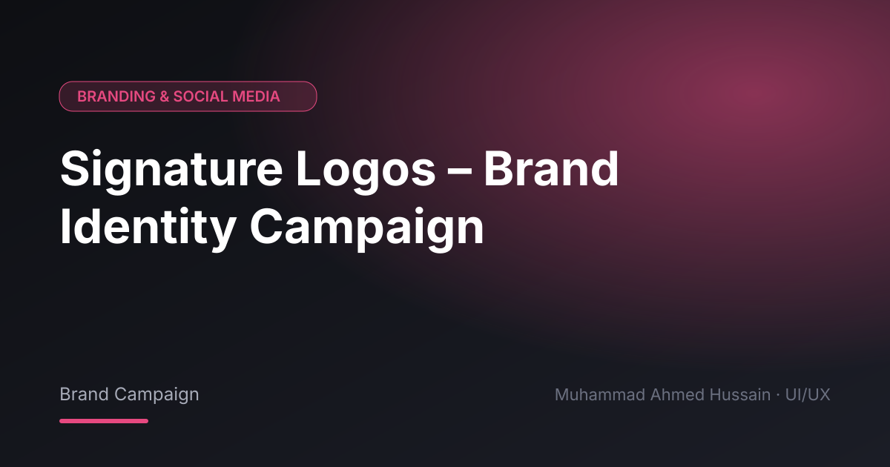

# Signature Logos – Brand Identity Campaign

**Category:** Branding & Social Media · **Type:** Brand Campaign · **Tool:** Figma

A brand identity campaign for Signature Logos.

## The challenge

The campaign needed a consistent look across many pieces.

## What I designed

- Campaign visuals
- Social media assets
- Brand guidelines

## Approach

One visual system applied across every touchpoint.

## Screens

<!-- Add exported screens to the images/ folder, then list them here, e.g.  -->
_Screens are in the [`images`](images/) folder._

## Process

Discovery → wireframes and user flows → high-fidelity UI with a component library → clickable prototype → developer-ready handoff.

---

[← Back to all projects](../../../README.md) · [Hire me on Upwork](https://www.upwork.com/freelancers/~01a964112574c69119)
