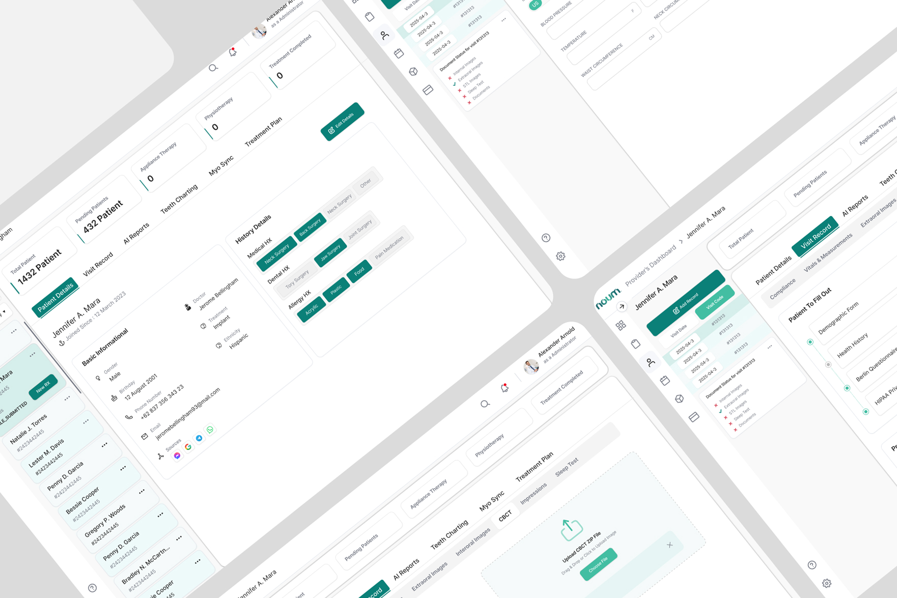
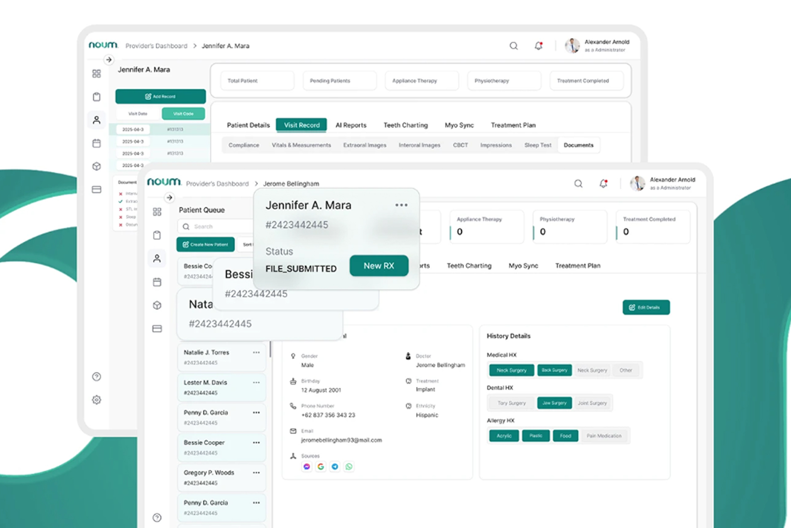
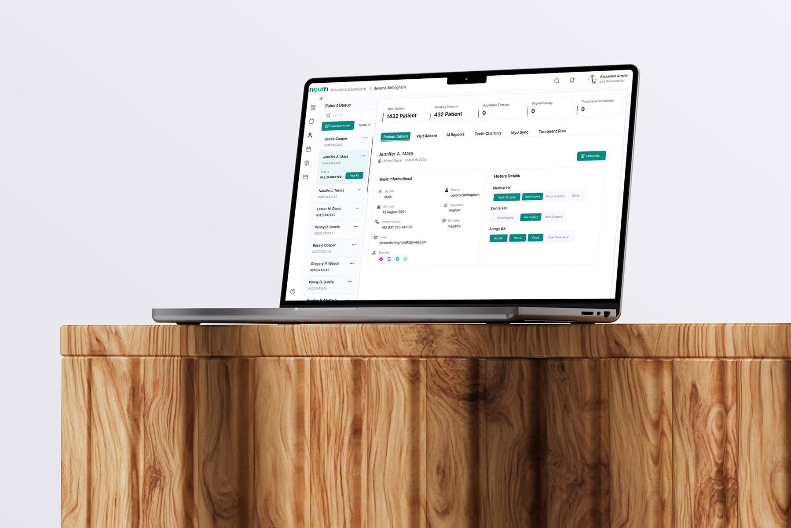
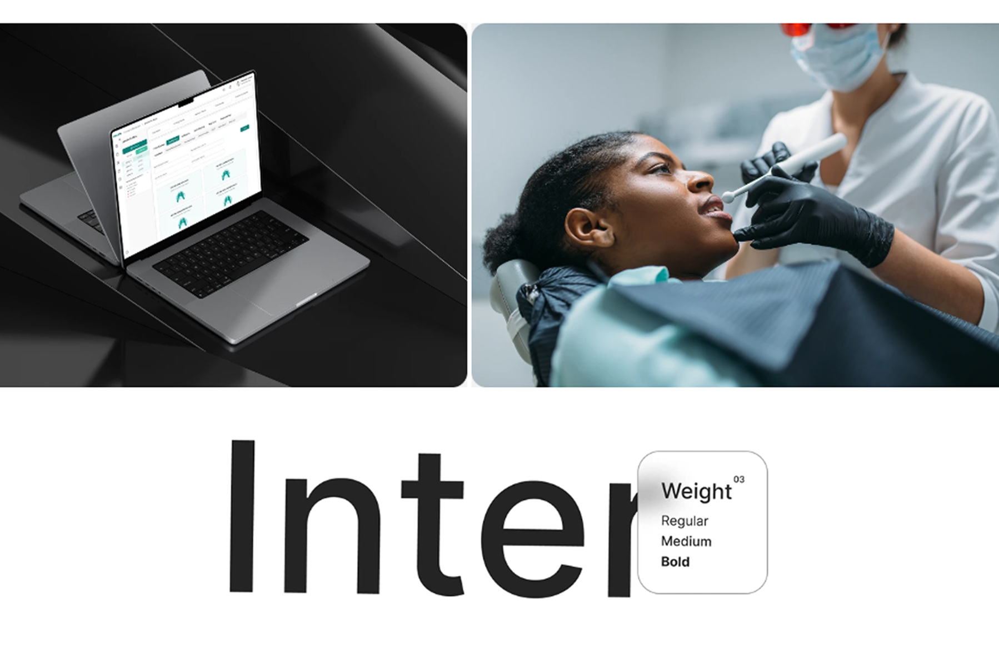

# Noum – Dental Clinic Provider Dashboard UI/UX Design (HealthTech SaaS)

**Category:** SaaS & Dashboards · **Platform:** Web App · **Industry:** Healthcare / Dental · **Tool:** Figma

Noum is a provider dashboard for dental and sleep-therapy clinics. It brings the patient queue, patient records, visit history, AI reports, teeth charting and treatment planning into one workspace. I designed the provider experience end to end.

## The challenge

Dental providers switch between patient lists, medical history, imaging files, forms and treatment plans all day, often in separate tools. Noum needed one screen where a provider can pick a patient from the queue and see everything about them in tabs, without losing their place.

## What I designed

- **Patient Queue:** a searchable side list with *Create New Patient*, sorting, patient IDs, file status (e.g. FILE_SUBMITTED) and a **New RX** action
- **KPI row:** Total Patients, Pending Patients, Appliance Therapy, Physiotherapy and Treatment Completed
- **Patient workspace tabs:** Patient Details, Visit Record, AI Reports, Teeth Charting, Myo Sync and Treatment Plan
- **Patient details:** basic information (gender, birthday, phone, email, doctor, treatment, lead sources) and **History Details** chips for Medical, Dental and Allergy history, with **Edit Details**
- **Visit Record:** a dated visit list with *Add Record* / *Visit Code*, a document checklist for each visit (intraoral and extraoral images, STL files, sleep test, documents), *Vitals & Measurements* (blood pressure, temperature, waist and neck circumference) and *Compliance*
- **Patient forms:** a tracker for forms the patient fills out (Demographic, Health History, Berlin Questionnaire, HIPAA)
- **CBCT upload:** a drag-and-drop zone for CBCT ZIP files

## Visual style

- **Type:** Inter in Regular, Medium and Bold, clean and highly legible for dense clinical data
- **Calm clinical palette:** deep teal for primary actions and active tabs, on clean white and light-grey surfaces
- **Chips and badges** turn medical history into quick, scannable tags
- **Dense but readable:** compact typography and clear grouping for data-heavy screens

## Approach

- **Queue + workspace layout.** The patient list stays on the left, so providers never lose their place.
- **Tabs mirror the clinical workflow:** details → visit → AI reports → charting → treatment.
- **Status at a glance:** document checklists with ✓ / ✗ show what's missing before an appointment.
- **Built for real clinics:** sleep-therapy and myofunctional workflows (Berlin Questionnaire, Myo Sync, CBCT) are first-class, not add-ons.

## Process

Discovery with the clinic workflow → information architecture → wireframes → high-fidelity UI → component library → developer handoff.

## Figma file

[Open the design in Figma](https://www.figma.com/design/Ied4wzNf1IpgcTaWrzTLbu/Dental-Portal-NOUM?node-id=3-8)

**Tags:** SaaS Dashboard Design · Dashboard UI · Admin Panel Design · Web App UI/UX · Data Visualization · UX Case Study · Figma · UI/UX Designer

---

[← Back to all projects](../../../README.md) · [Hire this UI/UX designer on Upwork](https://www.upwork.com/freelancers/~01a964112574c69119)
