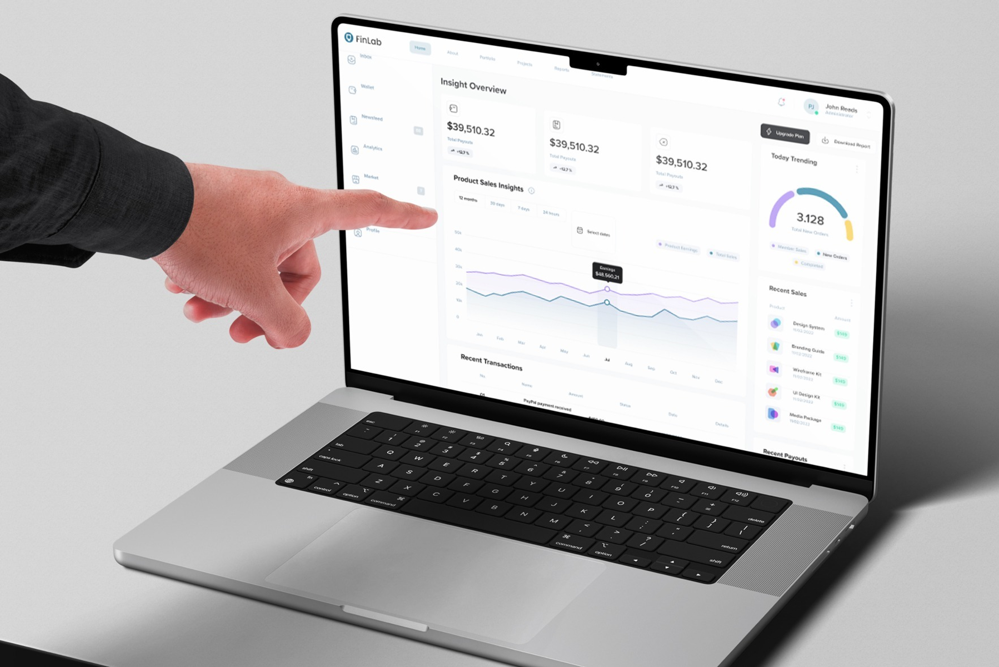
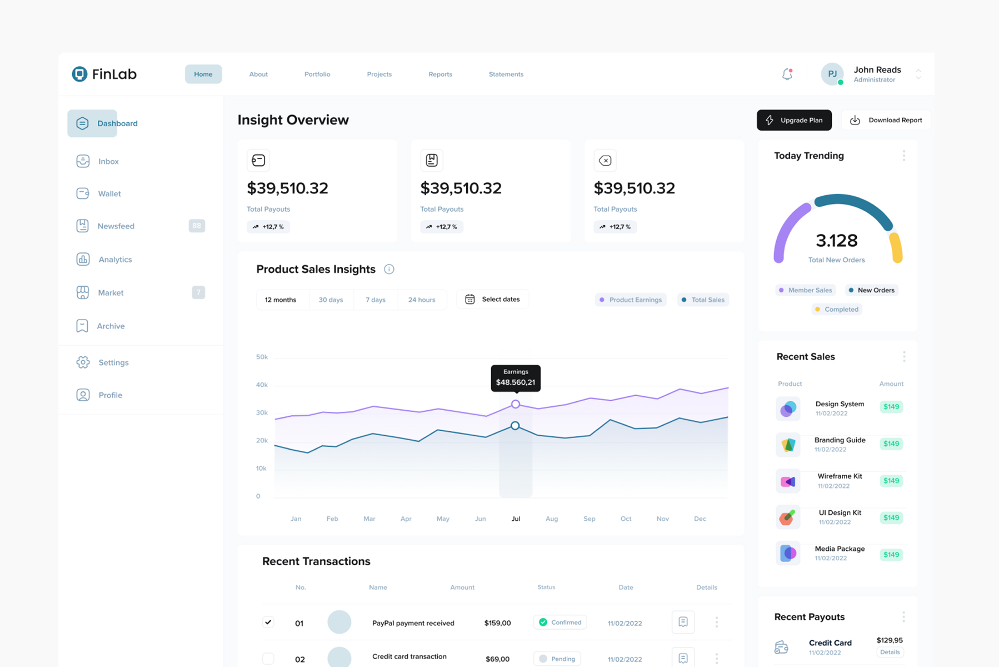
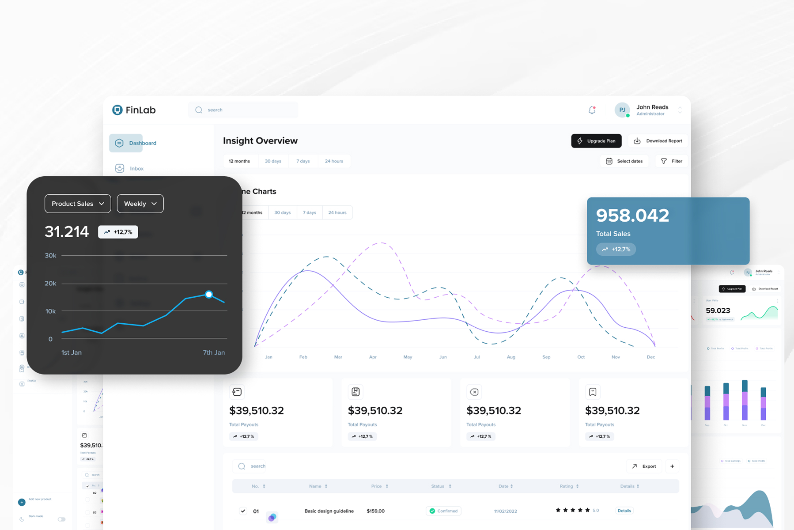
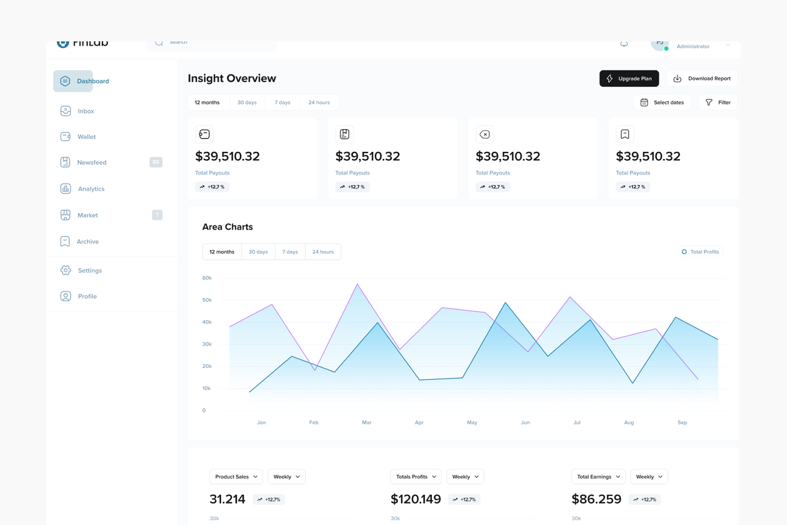
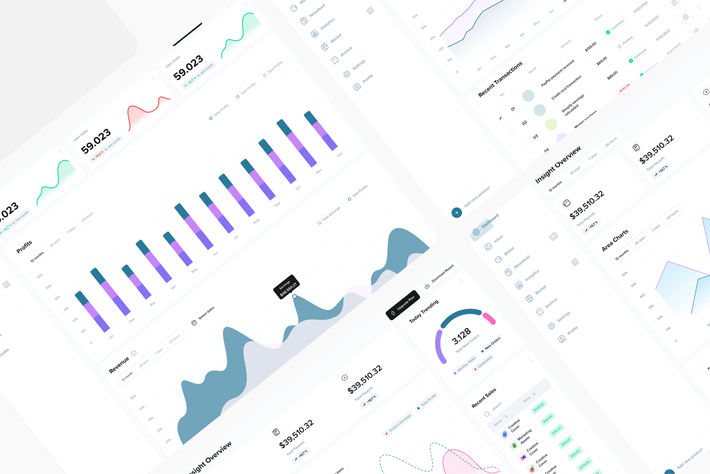

# FinLab – SaaS Finance Dashboard UI/UX Design

**Category:** SaaS & Dashboards · **Platform:** Web App · **Industry:** Fintech · **Tool:** Figma

FinLab is a SaaS finance dashboard for businesses that sell digital products. It brings payouts, sales, orders, transactions and analytics into one clean admin panel. I designed the dashboard UI, the chart system and the reusable components behind it.

## The challenge

Finance data is dense, and most dashboards show everything at once. FinLab's users needed to answer three questions in seconds: *How much did we make? What's trending today? What needs my attention?* They also needed to be able to dig into details without leaving the page.

## What I designed

- **Insight Overview:** a KPI row of payout cards, each with an icon, amount and growth badge (+12.7%), plus **Upgrade Plan** and **Download Report** actions
- **Product Sales Insights:** a dual-line chart (Product Earnings vs Total Sales) with 12 months / 30 days / 7 days / 24 hours filters, a custom date picker and a hover tooltip
- **Today Trending:** a segmented gauge for total new orders (member sales, new orders, completed)
- **Recent Sales and Recent Payouts** side panels for a quick scan
- **Recent Transactions:** a sortable table with status chips (Confirmed, Pending), dates and detail actions
- **Analytics views:** area charts, stacked profit bars, revenue curves, user-visit sparkline cards and weekly mini-charts (Product Sales, Total Profits, Total Earnings)
- **Navigation:** a sidebar (Dashboard, Inbox, Wallet, Newsfeed, Analytics, Market, Archive, Settings, Profile) with badges, a top bar with search and notifications, *Add new product* and a dark-mode toggle

## Approach

- **Overview first, detail on demand.** KPIs at the top, trends in the middle, transactions at the bottom.
- **One time filter pattern everywhere.** The same 12m / 30d / 7d / 24h control on every chart, so users learn it once.
- **Calm, data-friendly palette.** Soft whites with teal-blue and violet data colours keep charts readable and help status chips stand out.
- **Built as a component system.** Cards, chart widgets, tables and filters are reusable, so new screens stay consistent.

## Process

Discovery → key metrics and user questions → information architecture → wireframes → high-fidelity UI → chart and component library → developer handoff.

## Figma file

[Open the design in Figma](https://www.figma.com/design/wDaU062gleeH63fqpnNjXQ/Finance)

**Tags:** SaaS Dashboard Design · Dashboard UI · Admin Panel Design · Web App UI/UX · Data Visualization · UX Case Study · Figma · UI/UX Designer

---

[← Back to all projects](../../../README.md) · [Hire this UI/UX designer on Upwork](https://www.upwork.com/freelancers/~01a964112574c69119)
