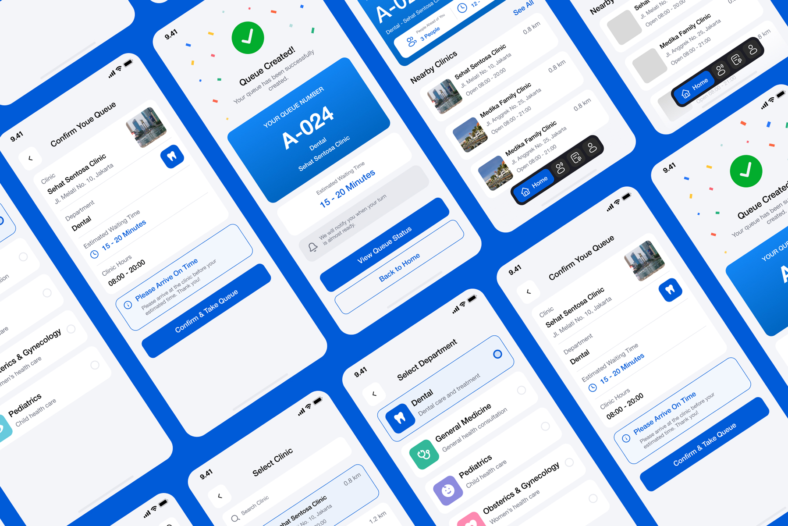
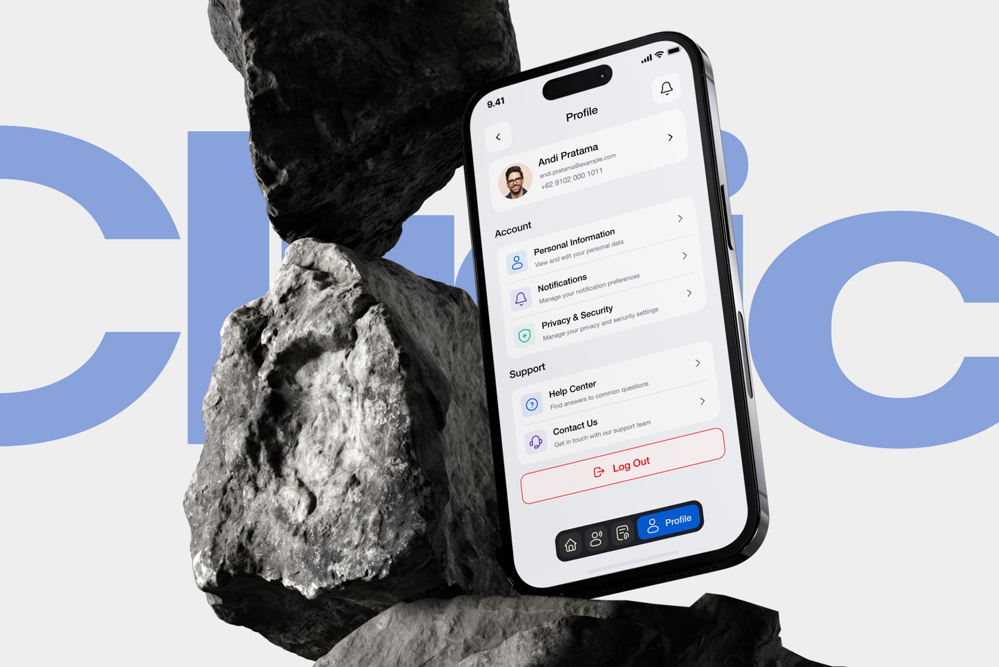
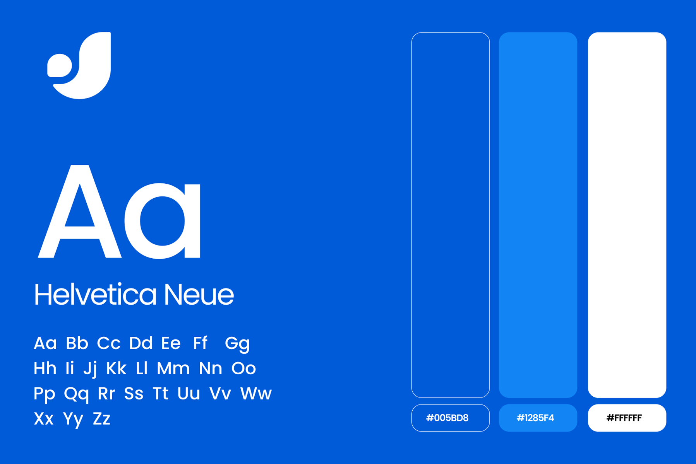

# Clinic Appointment Booking App – iOS & Android UI/UX Design

**Category:** Mobile App Design · **Platform:** iOS & Android · **Industry:** Healthcare · **Tool:** Figma

A mobile app that lets patients find a nearby clinic, pick a department and take a queue number before they leave home. Instead of waiting in a crowded lobby, patients see how many people are ahead of them and how long the wait will be, and they get a notification when it's almost their turn.

## The challenge

At walk-in clinics, patients usually show up, take a paper ticket and wait with no idea how long it will take. The app needed to move that whole experience to the phone: choose a clinic, choose a department, join the queue and get there on time. Every step had to be simple enough for any patient, at any age, to finish on the first try.

## What I designed

- **Home:** an active queue card (queue number, clinic, people ahead and time left) at the top, then a *Nearby Clinics* list with distance, address and opening hours
- **Select Clinic:** search, with clinic cards showing distance so the closest option is clear
- **Select Department:** Dental, General Medicine, Pediatrics, Obstetrics & Gynecology, each with its own colour-coded icon and a one-line description
- **Confirm Your Queue:** a summary of clinic, department, estimated waiting time (15–20 minutes) and clinic hours, plus a *Please arrive on time* reminder before the patient taps **Confirm & Take Queue**
- **Queue Created:** a success screen with a big, readable queue number (A-024), the estimated wait, a "we'll notify you when your turn is almost ready" message and quick actions to *View Queue Status* or go *Back to Home*
- **Profile:** personal information, notifications, privacy & security, help center, contact us and a clearly separated log out
- **Navigation:** a floating pill-style bottom bar (Home, Queue, History, Profile) that expands to label the active tab

## Visual style

- **Colour:** a calm, trustworthy blue palette, Primary `#005BD8`, Secondary `#1285F4` and White `#FFFFFF`, with soft department accent colours
- **Type:** Helvetica Neue, kept clean and highly readable for health information
- **Brand mark:** a simple, friendly logo built for app icons and small sizes

## Approach

- **Show the wait, remove the anxiety.** People ahead, estimated time and the queue number are always the biggest things on screen.
- **One decision per screen.** Clinic → department → confirm. No long forms.
- **Confirm before committing.** The summary screen catches mistakes and reminds patients to arrive on time, which cuts down on no-shows.
- **Large touch targets and clear labels** keep it usable for older patients and parents with kids.

## Process

Discovery → user flow (find → choose → confirm → wait) → wireframes → high-fidelity UI → clickable prototype → developer handoff.

**Tags:** Mobile App Design · iOS App Design · Android App Design · Mobile UI · UX Case Study · Figma Prototype · Figma · UI/UX Designer

---

[← Back to all projects](../../../README.md) · [Hire this UI/UX designer on Upwork](https://www.upwork.com/freelancers/~01a964112574c69119)
