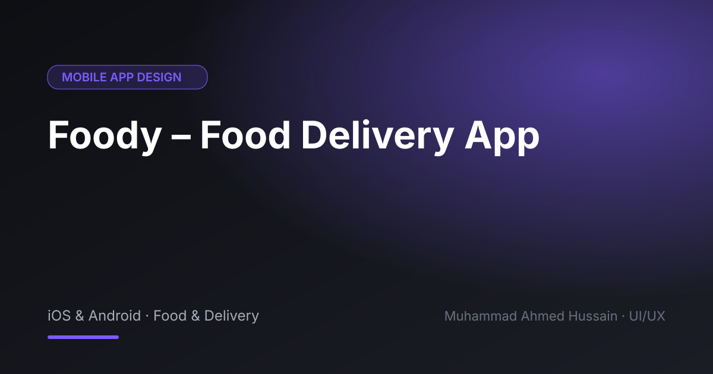

# Foody – Food Delivery App

**Category:** Mobile App Design · **Type:** iOS & Android · Food & Delivery · **Tool:** Figma

A restaurant and food delivery app with a short path from craving to checkout.

## The challenge

Food apps live or die on how fast people can browse a menu, customise an order and pay.

## What I designed

- Restaurant discovery and categories
- Menu and item customisation
- Cart and checkout
- Order tracking

## Approach

Big food photography, clear prices and a cart that is always reachable keep the order moving.

## Screens

<!-- Add exported screens to the images/ folder, then list them here, e.g.  -->
_Screens are in the [`images`](images/) folder._

## Figma file

[Open the design in Figma](https://www.figma.com/design/VbPcz6xr3dhA6K3PeSVz2u/Foody-Restaurant-App?node-id=1-431)

## Process

Discovery → wireframes and user flows → high-fidelity UI with a component library → clickable prototype → developer-ready handoff.

**Tags:** Mobile App Design · iOS App Design · Android App Design · Mobile UI · UX Case Study · Figma Prototype · Figma · UI/UX Designer

---

[← Back to all projects](../../../README.md) · [Hire this UI/UX designer on Upwork](https://www.upwork.com/freelancers/~01a964112574c69119)
