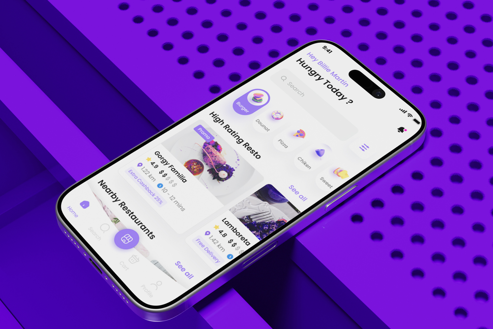
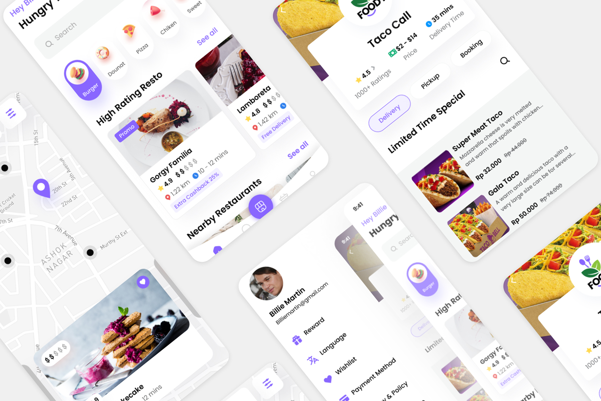
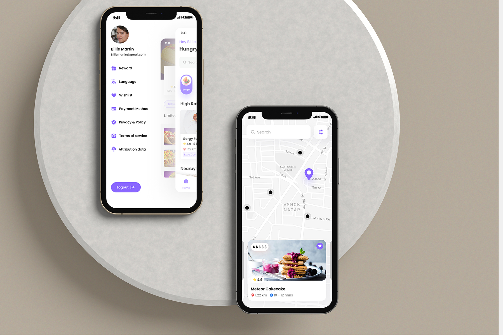
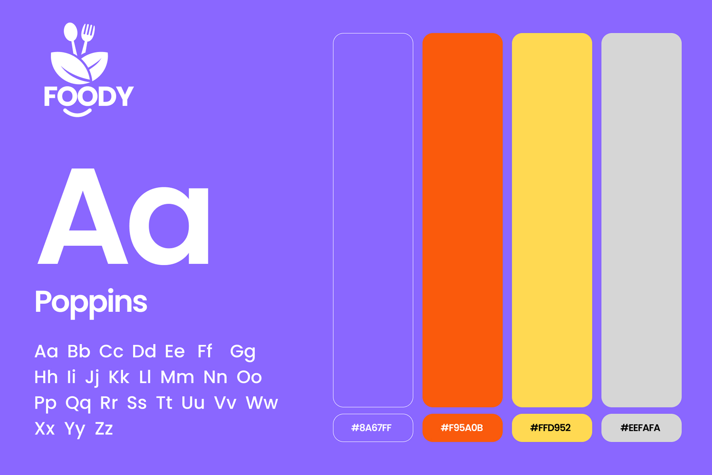

# Foody – Food Delivery Mobile App UI/UX Design

**Category:** Mobile App Design · **Platform:** iOS & Android · **Industry:** Food & Delivery · **Tool:** Figma

Foody is a food delivery app with one goal: get a hungry person from "what should I eat?" to an order in as few taps as possible. I designed the brand style and the app UI, from discovery through to the restaurant cards that drive orders.

## The challenge

Food apps compete on speed and appetite appeal. Users scroll fast and decide on instinct, so the home screen has to suggest something tasty right away, show the deals that matter (cashback, free delivery) and make the cart always reachable.

## What I designed

- **Personal home screen:** a friendly greeting ("Hey Billie Martin, Hungry Today?"), search and a filter button
- **Category chips** with playful 3D food icons (Burger, Donut, Pizza, Chicken, Sweet), with the active chip highlighted in violet
- **High Rating Resto:** restaurant cards with rating, price level, distance, delivery time and offer tags (Promo, Extra Cashback 25%)
- **Nearby Restaurants:** a second list ranked by distance, with Free Delivery badges
- **Bottom navigation** (Home, Search, Cart, Profile) with a raised centre action button
- **Restaurant page (Taco Call):** rating (4.5, 1000+ ratings), price range, delivery time, **Delivery / Pickup / Booking** tabs and a *Limited Time Special* menu with discounted prices
- **Map discovery:** search and filters over a map with restaurant pins and a swipeable food card (rating, distance, delivery time, favourite)
- **Profile menu:** Reward, Language, Wishlist, Payment Method, Privacy & Policy, Terms of Service and Logout

## Brand style

- **Logo:** a friendly spoon-and-fork mark with a smile
- **Type:** Poppins
- **Colour:** violet `#8A67FF` as the brand colour, bright orange `#F95A0B` for appetite and alerts, sunny yellow `#FFD952` for ratings and highlights, and soft `#EEFAFA` for surfaces

## Approach

- **Appetite first.** Big food imagery and 3D icons make browsing feel fun.
- **Deals where decisions happen.** Cashback and free delivery sit on the cards, not hidden in a promo tab.
- **Key facts at a glance:** rating, distance, time and price level on every card.
- **The cart is always one tap away** through the centre nav button.

## Process

Discovery → ordering flow (browse → choose → cart → checkout) → wireframes → brand style → high-fidelity UI → prototype → developer handoff.

## Figma file

[Open the design in Figma](https://www.figma.com/design/VbPcz6xr3dhA6K3PeSVz2u/Foody-Restaurant-App?node-id=1-431)

**Tags:** Mobile App Design · iOS App Design · Android App Design · Mobile UI · UX Case Study · Figma Prototype · Figma · UI/UX Designer

---

[← Back to all projects](../../../README.md) · [Hire this UI/UX designer on Upwork](https://www.upwork.com/freelancers/~01a964112574c69119)
