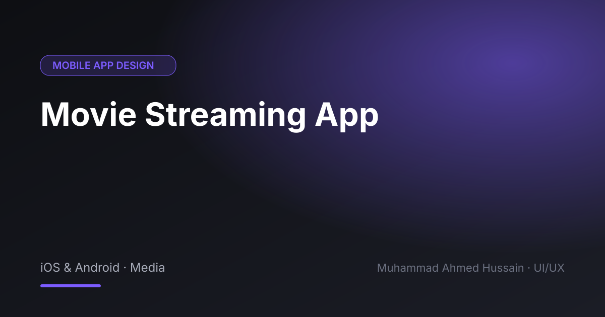

# Movie Streaming App

**Category:** Mobile App Design · **Type:** iOS & Android · Media · **Tool:** Figma

A streaming app UI with content discovery, title pages and a clean player experience.

## The challenge

Large catalogues overwhelm users. Discovery had to feel curated rather than endless.

## What I designed

- Home feed with curated rows
- Search and genre browsing
- Movie detail page with trailer
- Watchlist and continue watching

## Approach

Dark, cinematic theme that lets the posters lead, with continue-watching surfaced first.

## Screens

<!-- Add exported screens to the images/ folder, then list them here, e.g.  -->
_Screens are in the [`images`](images/) folder._

## Figma file

[Open the design in Figma](https://www.figma.com/design/BxRSOGVD33MYNe5vkq6m3t/MOVIE-STREAMING-APP?node-id=0-1)

## Process

Discovery → wireframes and user flows → high-fidelity UI with a component library → clickable prototype → developer-ready handoff.

---

[← Back to all projects](../../../README.md) · [Hire me on Upwork](https://www.upwork.com/freelancers/~01a964112574c69119)
