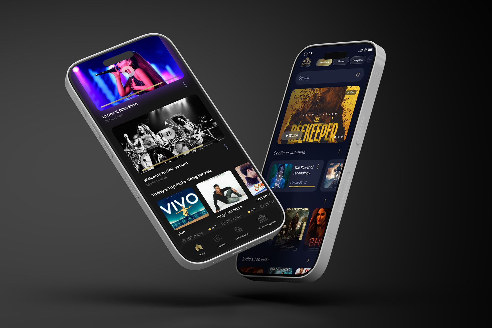
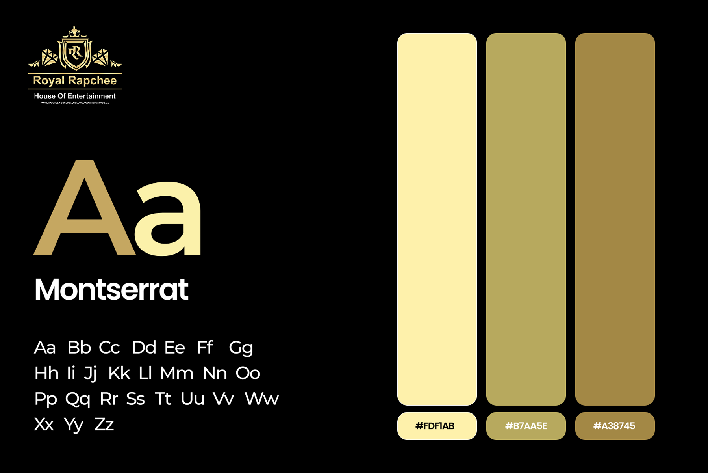

# Royal Rapchee – Movie & Music Streaming App UI/UX Design

**Category:** Mobile App Design · **Platform:** iOS & Android · **Industry:** Media / Streaming · **Tool:** Figma

Royal Rapchee ("House of Entertainment") is a streaming app for movies, web shows, cartoons and music videos. I designed a premium, cinematic UI that makes a big catalogue feel curated and keeps viewers watching.

## The challenge

Streaming apps have huge catalogues and short attention spans. Royal Rapchee needed a home screen that sells one featured title instantly, makes it easy to pick up where you left off, and brings movies, shows and music together without feeling cluttered. All of this had to carry a luxury brand.

## What I designed

- **Featured hero:** a full-bleed title with short synopsis, a **Trailer** / **Watch** button and carousel dots
- **Content tabs:** Web Show, Movies, Categories, plus search
- **Rows:** TV Shows, *Continue Watching* (with progress bars and time watched), *India's Top Picks* and *Trailer Out Now*, each card showing rating, duration and tags like *Coming soon* and *18+*
- **Music videos:** *Today's Top Picks – Songs for You* with playback progress, artist and genre
- **Bottom navigation:** Home, Cartoon, Coming Soon and *My Royal Rapchee*
- **Two themes:** deep black and midnight navy, both with gold accents

## Visual style

- **Logo:** a royal crest with the "Royal Rapchee – House of Entertainment" wordmark
- **Type:** Montserrat
- **Colour:** gold tones `#FDF1AB`, `#B7AA5E` and `#A38745` on black, for a premium cinema feel

## Approach

- **Let the posters lead.** Dark backgrounds and minimal chrome put the artwork first.
- **Continue Watching comes first** after the hero, since returning viewers are the most valuable.
- **Consistent card metadata** (rating, duration, badges) makes rows quick to scan.
- **Gold used sparingly** for active tabs, buttons and progress, so the premium feel never becomes noisy.

## Process

Discovery → content structure (movies, shows, music) → wireframes → brand style → high-fidelity UI → prototype → developer handoff.

## Figma file

[Open the design in Figma](https://www.figma.com/design/BxRSOGVD33MYNe5vkq6m3t/MOVIE-STREAMING-APP?node-id=0-1)

**Tags:** Mobile App Design · iOS App Design · Android App Design · Mobile UI · UX Case Study · Figma Prototype · Figma · UI/UX Designer

---

[← Back to all projects](../../../README.md) · [Hire this UI/UX designer on Upwork](https://www.upwork.com/freelancers/~01a964112574c69119)
