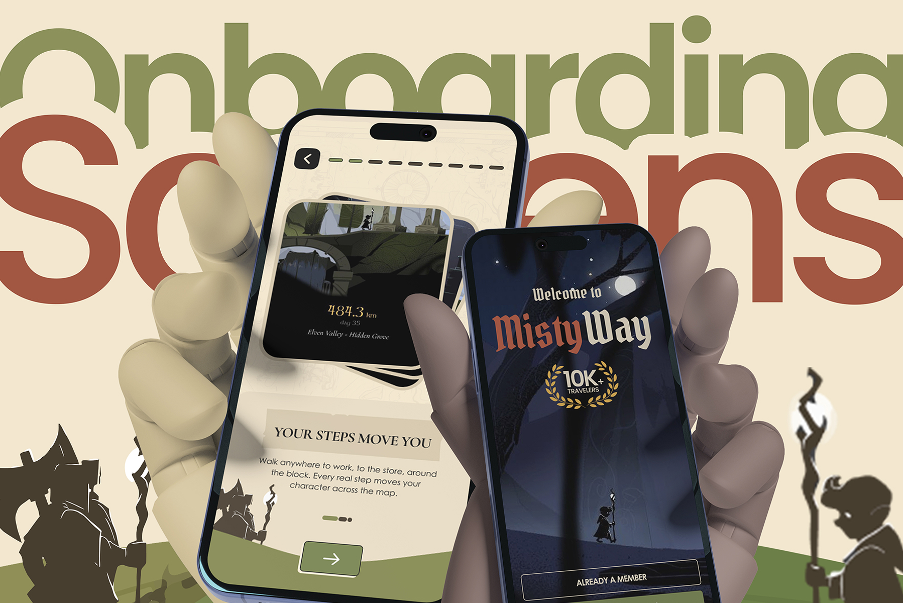
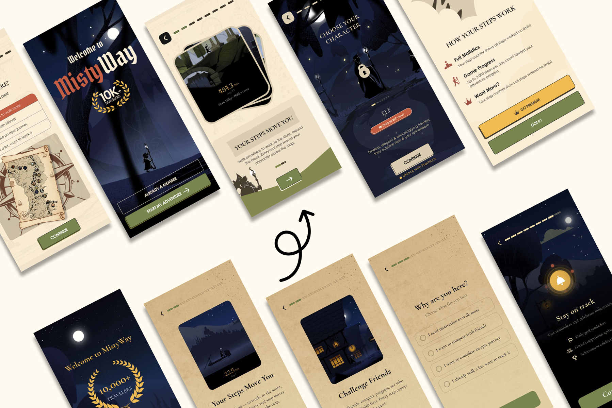
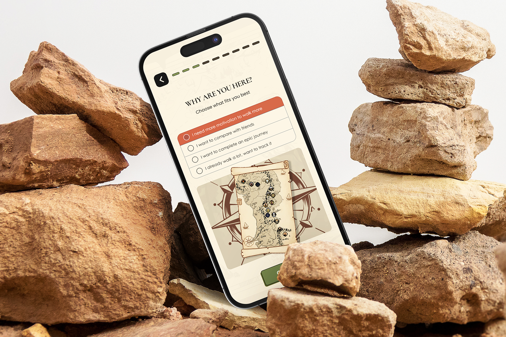
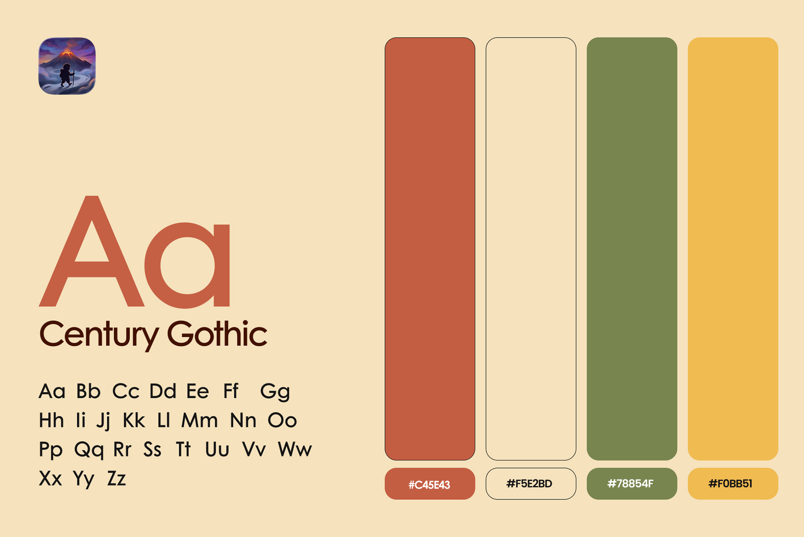

# MistyWay – Pedometer App Onboarding Screens Redesign | UI/UX Design

**Category:** Mobile App Design · **Platform:** iOS & Android · **Industry:** Health & Fitness / Gamified walking · **Tool:** Figma

MistyWay is a fantasy adventure step counter: every real step you walk moves your character across a hand-drawn map. I redesigned the app's onboarding, the first few minutes that decide whether a new user ever goes on that first walk.

## The challenge

The original onboarding (bottom row in the image below) had the right story, but it read like a stack of parchment pages: flat, text-heavy and with weak calls to action. New users had to understand three things fast: how steps turn into progress, why the adventure is fun, and what Premium unlocks. And it had to keep the fantasy mood without getting in the way.

## What I designed

- **Welcome to MistyWay:** a moody night-forest hero with a gothic logotype, a "10K+ travelers" badge and two clear paths, **Start my adventure** and **Already a member**
- **Your Steps Move You:** a stacked story card (484.3 km · day 35 · Elven Valley – Hidden Grove) that shows the core idea in one picture: "Every real step moves your character across the map"
- **Why are you here?:** a goal picker (more motivation, compete with friends, complete an epic journey, already walk a lot) with an illustrated treasure map, so the app can personalise from day one
- **Choose your character:** a character carousel (Elf and more) with a locked state, *Unlock Elf now* and an *Unlock with Premium* upsell
- **How your steps work:** full statistics, game progress (up to 3,000 steps a day count toward your adventure) and a soft Premium offer with **Go Premium** / **Got it!**
- **Challenge Friends** and **Stay on track:** social competition plus permission priming for daily goal reminders, friend updates and achievement celebrations
- **Progress bar** at the top of every step, so users always know how much is left

## Visual style

- **Type:** Century Gothic for UI text, paired with fantasy display lettering for the brand
- **Colour:** terracotta `#C45E43`, parchment `#F5E2BD`, olive green `#78854F` and gold `#F0BB51`
- **Look:** parchment light screens alternate with deep night scenes for rhythm, and silhouette characters and illustrated maps carry the story

## Approach

- **Show the game loop first.** "Steps → distance → new places on the map" is explained with a picture before any settings.
- **One decision per screen**, with one big primary button and a progress bar.
- **Personalise early.** The "Why are you here?" answer shapes reminders and goals.
- **Upsell without blocking.** Premium is offered at natural moments (locked characters, step limits), and there's always a free path forward.
- **Ask for permissions with context.** Reminders are introduced as "stay on track" benefits before the system prompt appears.

## Process

Audit of the existing onboarding → drop-off points and goals → new flow and wireframes → high-fidelity UI → clickable prototype → developer handoff.

**Tags:** Mobile App Design · iOS App Design · Android App Design · Mobile UI · UX Case Study · Figma Prototype · Figma · UI/UX Designer

---

[← Back to all projects](../../../README.md) · [Hire this UI/UX designer on Upwork](https://www.upwork.com/freelancers/~01a964112574c69119)
