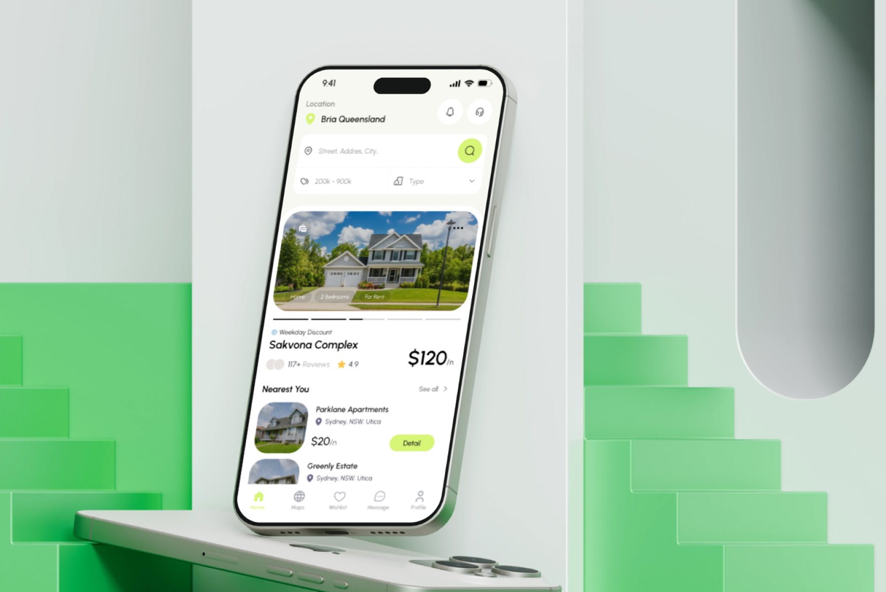
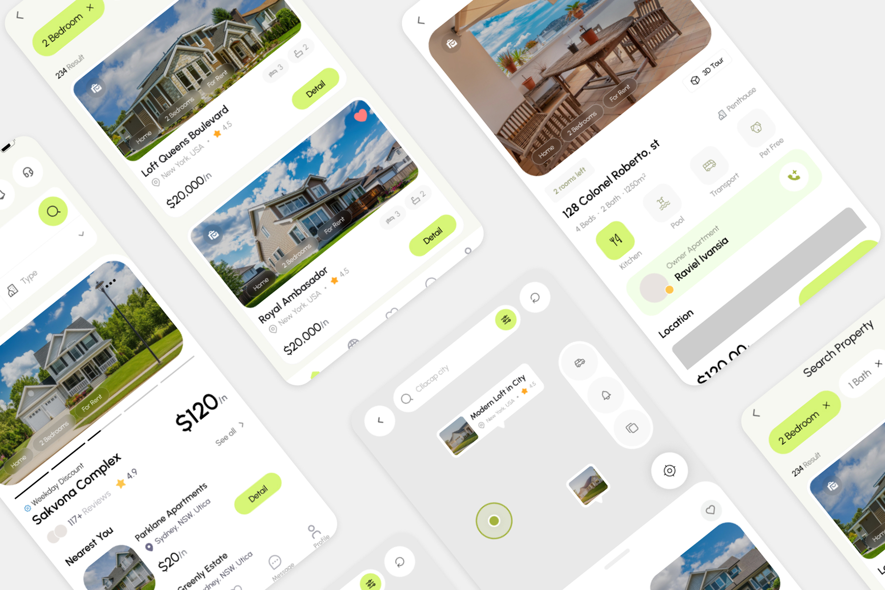
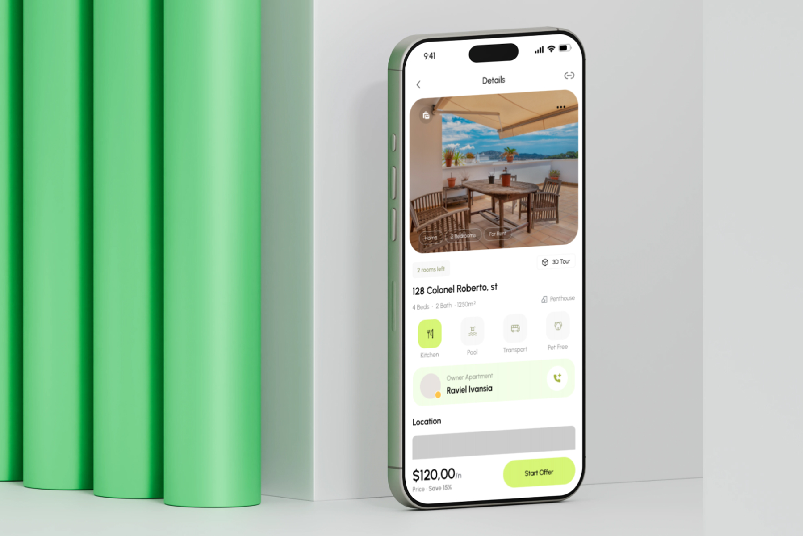
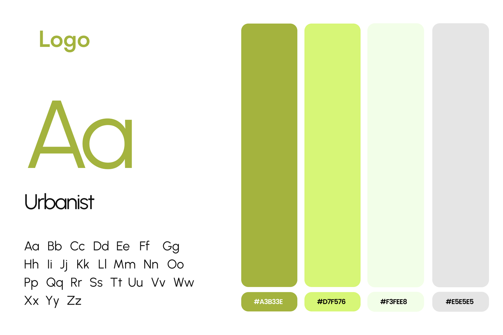

# Real Estate Mobile App UI/UX Design – Property Rental & Search

**Category:** Mobile App Design · **Platform:** iOS & Android · **Industry:** Real estate / Property rental · **Tool:** Figma

A property rental and search app that helps people find a home, compare listings and contact the owner without endless scrolling. I designed the core flow: home, search and filters, map view, property details and making an offer.

## The challenge

Property apps are full of near-identical listing cards. Renters want to filter fast, see the real place, check key facts and contact the owner, all on a small screen. The design needed to make browsing feel light and visual while still putting price, size and amenities right where people look.

## What I designed

- **Home:** current location, a search bar (street, address, city), quick price-range and property-type filters, a featured listing carousel (Sakvona Complex, rating, 117+ reviews, weekday discount) and a *Nearest You* list
- **Search results:** filter chips (2 Bedroom, 1 Bath), result count, favourites and big photo-first cards with price per night and tags (Home, 2 Bedrooms, For Rent)
- **Map view:** property pins with preview cards, search, filters and a locate-me button
- **Property details:** availability ("2 rooms left"), 3D Tour, address, beds/baths/size, property type, amenity icons (Kitchen, Pool, Transport, Pet Free), owner card with a one-tap call button, location and a sticky price bar with **Start Offer**
- **Bottom navigation:** Home, Maps, Wishlist, Message, Profile

## Visual style

- **Type:** Urbanist, geometric and friendly for prices and listing titles
- **Colour:** olive `#A3B33E`, fresh lime `#D7F576`, mint white `#F3FEE8` and light grey `#E5E5E5`
- **UI:** soft rounded cards, photo-first layouts and lime accents for primary actions

## Approach

- **Photos lead, facts follow.** Big images first, then price, rating and tags at a glance.
- **Filters always one tap away**, as chips on the results page and quick filters on home.
- **Trust and contact built in.** Owner details and a call button sit right on the details page.
- **Sticky price and CTA**, so "Start Offer" is always reachable while scrolling.

## Process

Discovery → renter journey mapping (search → compare → contact) → wireframes → high-fidelity UI → clickable prototype → developer handoff.

## Figma file

[Open the design in Figma](https://www.figma.com/design/eJLYCgIOYaXBBAeaJiV3Tp/Hously---Real-Estate-App?node-id=0-1)

**Tags:** Mobile App Design · iOS App Design · Android App Design · Mobile UI · UX Case Study · Figma Prototype · Figma · UI/UX Designer

---

[← Back to all projects](../../../README.md) · [Hire this UI/UX designer on Upwork](https://www.upwork.com/freelancers/~01a964112574c69119)
