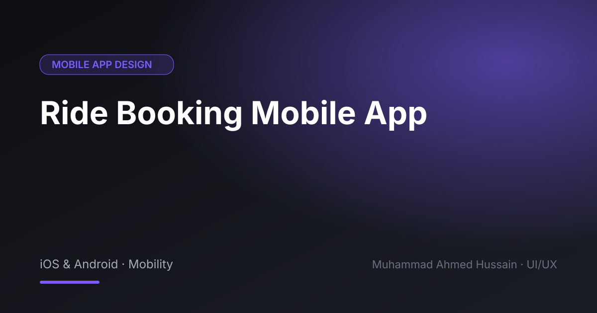

# Ride Booking Mobile App

**Category:** Mobile App Design · **Type:** iOS & Android · Mobility · **Tool:** Figma

A ride-hailing experience covering pickup, ride options, live tracking and payment.

## The challenge

Riders want to know three things fast: where the driver is, how long it takes and what it costs.

## What I designed

- Pickup and destination entry
- Ride type and fare comparison
- Live driver tracking
- Payment, rating and trip history

## Approach

Map-first layout with a bottom sheet that changes with each stage of the trip, so the next action is always obvious.

## Screens

<!-- Add exported screens to the images/ folder, then list them here, e.g.  -->
_Screens are in the [`images`](images/) folder._

## Process

Discovery → wireframes and user flows → high-fidelity UI with a component library → clickable prototype → developer-ready handoff.

**Tags:** Mobile App Design · iOS App Design · Android App Design · Mobile UI · UX Case Study · Figma Prototype · Figma · UI/UX Designer

---

[← Back to all projects](../../../README.md) · [Hire this UI/UX designer on Upwork](https://www.upwork.com/freelancers/~01a964112574c69119)
