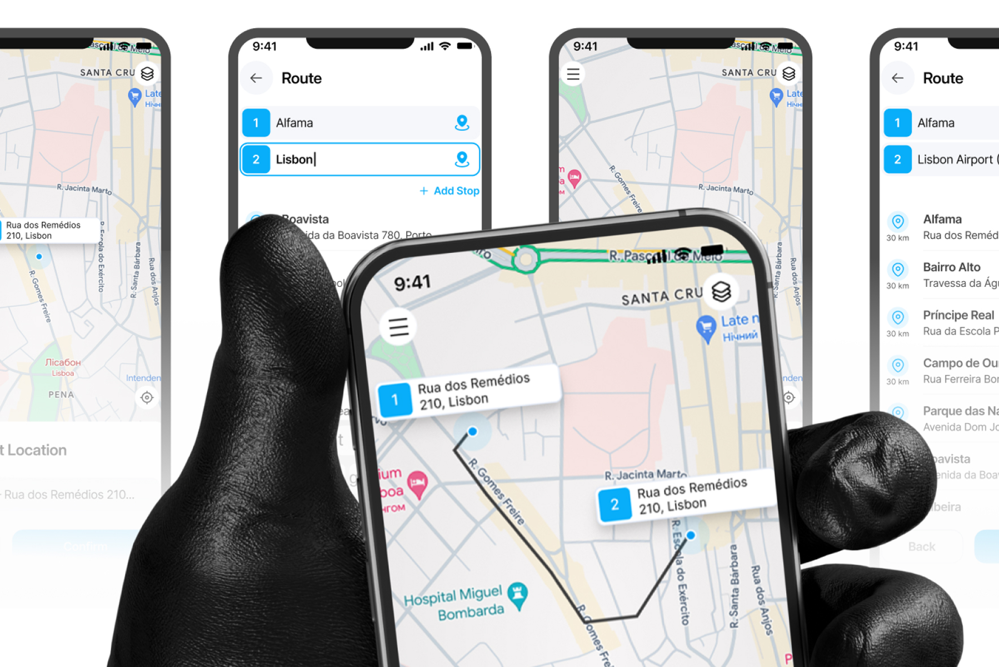
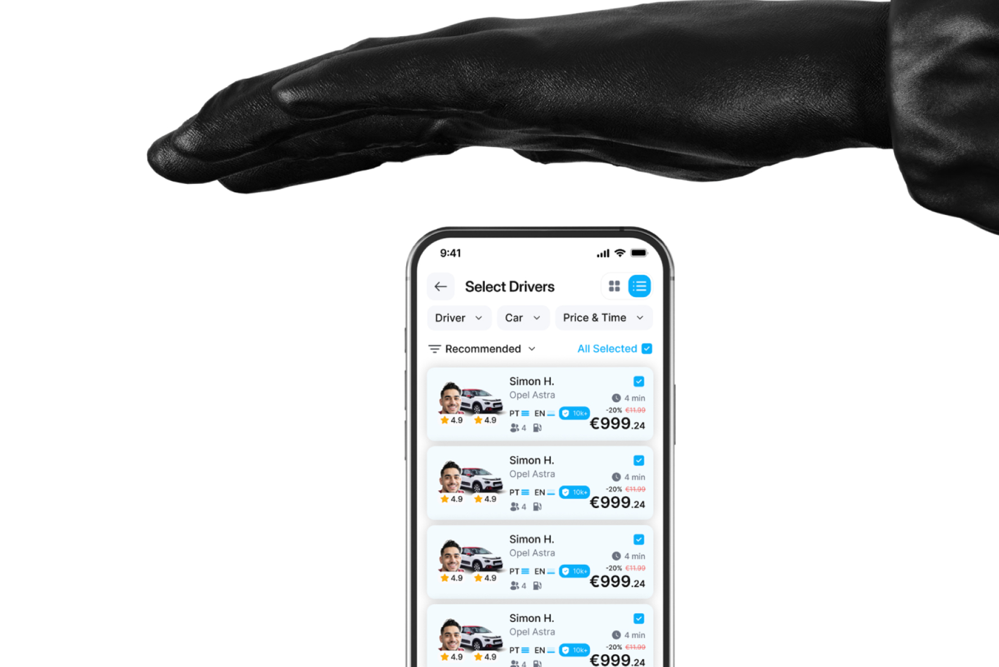
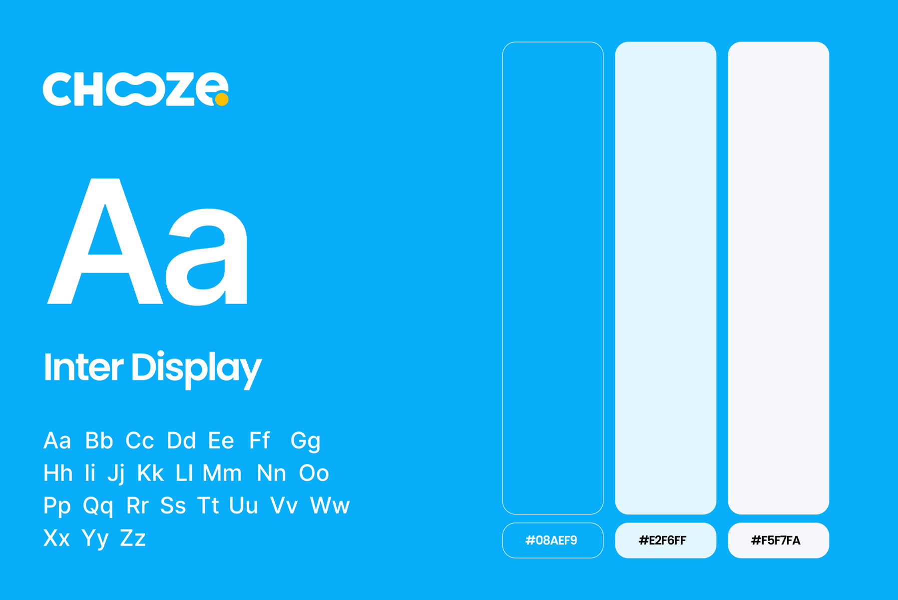

# Chooze – Ride Booking Mobile App UI/UX Design

**Category:** Mobile App Design · **Platform:** iOS & Android · **Industry:** Mobility / Ride hailing · **Tool:** Figma

Chooze is a ride booking app built around choice. Instead of being handed one random driver, riders plan a route with several stops and then compare drivers, cars and prices side by side before booking. I designed the route planner, driver selection and brand style.

## The challenge

Most ride apps hide the decision: you tap "Request" and hope for the best. Chooze wanted to give riders control (who drives, what car, what price) without making booking slower. Planning routes with multiple stops and comparing many drivers on a small screen had to stay simple.

## What I designed

- **Route planner:** numbered stops (1 Alfama → 2 Lisbon Airport) with **Add Stop**, live suggestions with distance (Bairro Alto, Príncipe Real, Campo de Ourique, Parque das Nações…) and *Back / Confirm* actions
- **Map view:** the route drawn between numbered pins, address labels on each stop, layers and a locate-me button
- **Select location:** drop a pin and confirm the exact pickup address
- **Select Drivers:** filters for **Driver**, **Car** and **Price & Time**, a *Recommended* sort, grid/list toggle and *All Selected* multi-select
- **Driver cards:** photo with the car, name and model, separate driver and car ratings, spoken languages (PT / EN), a trust badge for 10k+ rides, seats, fuel type, ETA and the price with any discount

## Visual style

- **Logo:** a playful "Chooze" wordmark with a linked "oo" and a yellow dot
- **Type:** Inter Display, clear for addresses, prices and ETAs
- **Colour:** sky blue `#08AEF9` for actions and route numbers, ice blue `#E2F6FF` for highlights and `#F5F7FA` for surfaces

## Approach

- **Numbered stops everywhere.** The same 1, 2, 3 badges appear in the list and on the map, so the route always matches.
- **Compare, don't scroll.** Every driver card shows the same facts in the same place, so riders can compare at a glance.
- **Trust signals up front:** ratings, ride count and languages help riders pick confidently.
- **Clean, light map styling** keeps the route and pins as the focus.

## Process

Discovery → rider journey (plan → compare → book) → wireframes → brand style → high-fidelity UI → clickable prototype → developer handoff.

**Tags:** Mobile App Design · iOS App Design · Android App Design · Mobile UI · UX Case Study · Figma Prototype · Figma · UI/UX Designer

---

[← Back to all projects](../../../README.md) · [Hire this UI/UX designer on Upwork](https://www.upwork.com/freelancers/~01a964112574c69119)
