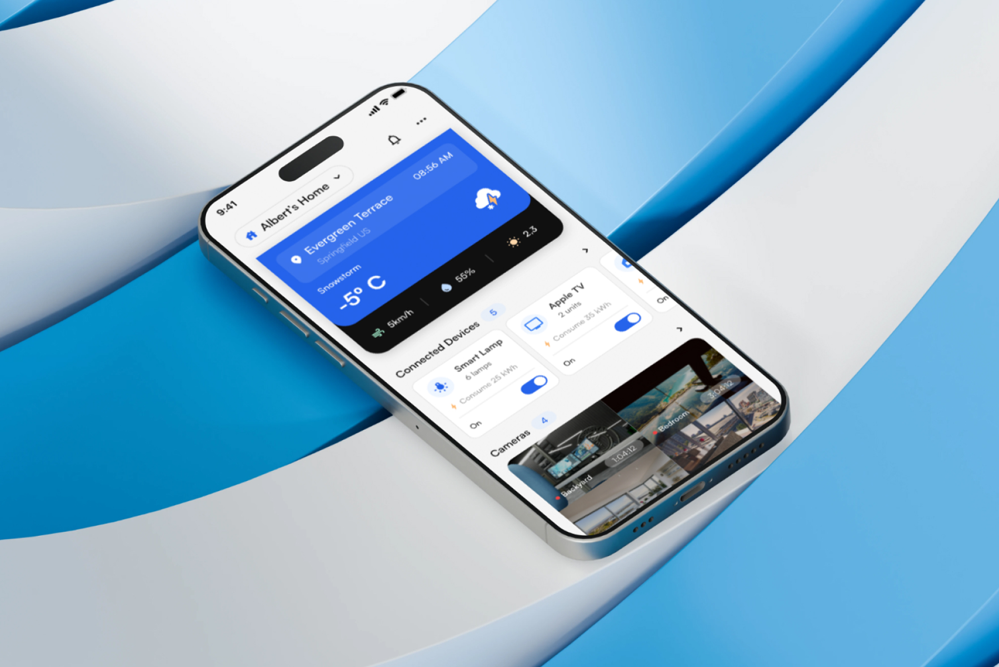
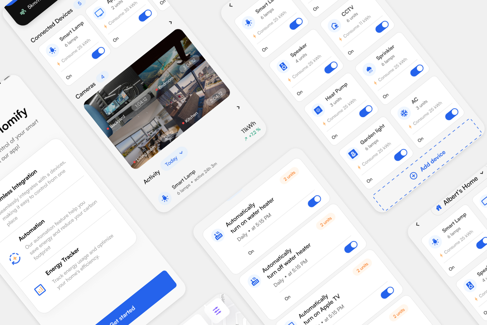
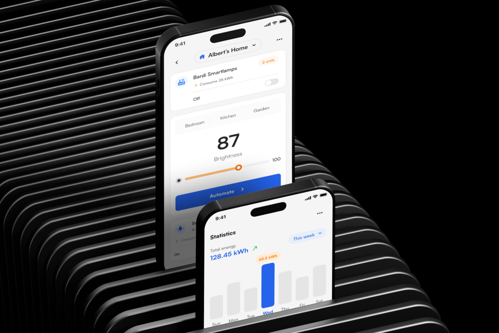
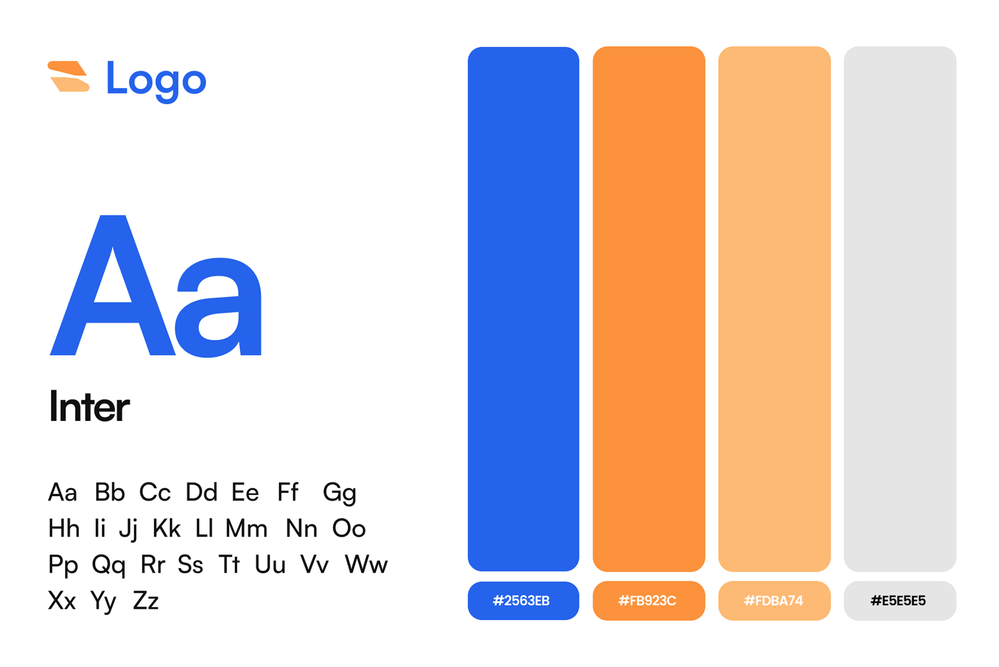

# Homify – Smart Home Mobile App UI/UX Design

**Category:** Mobile App Design · **Platform:** iOS & Android · **Industry:** IoT / Smart home · **Tool:** Figma

Homify is a smart home app that puts every connected device, camera and automation in one place, and helps people use less energy while they're at it. I designed the full app, from onboarding through device control to energy statistics.

## The challenge

Smart home owners juggle a different app for every brand of lamp, camera and heater. Homify had to bring them together without becoming a cluttered control panel. The everyday actions (turn it on, check the cameras, see what's using power) needed to be one tap away.

## What I designed

- **Onboarding:** "Take full control of your smart home with our app!" with three value points, *Seamless Integration*, *Automation* (save energy, reduce your carbon footprint) and *Energy Tracker*, then a *Get started* CTA
- **Home dashboard (Albert's Home):** a home switcher, a weather card (location, temperature, humidity, wind, UV), *Connected Devices* cards with on/off toggles and energy use, a live *Cameras* grid (Backyard, Bedroom, Kitchen, Living room) and a daily *Activity* feed
- **Devices:** a full device list (Smart Lamp, Apple TV, CCTV, Speaker, Sprinkler, Heat Pump, Garden Light, AC), each with unit count, kWh use and a toggle, plus an *Add device* tile
- **Device control:** room tabs (Bedroom, Kitchen, Garden), a large brightness readout (87), a slider and an *Automate* button
- **Automations:** scheduled rules such as "Automatically turn on water heater – Daily at 5:15 PM", each with its own toggle
- **Statistics:** weekly total energy (128.45 kWh) with a bar chart that highlights the peak day

## Visual style

- **Type:** Inter, clean and readable for lots of small labels and numbers
- **Colour:** primary blue `#2563EB` for actions and active states, orange `#FB923C` and peach `#FDBA74` for energy and unit badges, light grey `#E5E5E5` for surfaces
- **UI:** soft white cards, rounded corners and big toggles, so status is clear at a glance

## Approach

- **Status at a glance.** Every device card shows on/off, unit count and energy use, with no need to open it.
- **Most-used first.** Devices and cameras sit on the home screen, and deeper controls are one tap away.
- **Energy is built in, not bolted on.** kWh shows on every card, and automations and weekly stats help users actually cut usage.
- **One pattern everywhere.** Lights, AC and sprinklers all use the same card, so learning one means learning all.

## Process

Discovery → feature mapping (devices, cameras, automation, energy) → user flows → wireframes → high-fidelity UI → clickable prototype → developer handoff.

## Figma file

[Open the design in Figma](https://www.figma.com/design/s1k6HaurOndEL8za6FM32E/Smart-home-mobile-app?node-id=0-1)

**Tags:** Mobile App Design · iOS App Design · Android App Design · Mobile UI · UX Case Study · Figma Prototype · Figma · UI/UX Designer

---

[← Back to all projects](../../../README.md) · [Hire this UI/UX designer on Upwork](https://www.upwork.com/freelancers/~01a964112574c69119)
