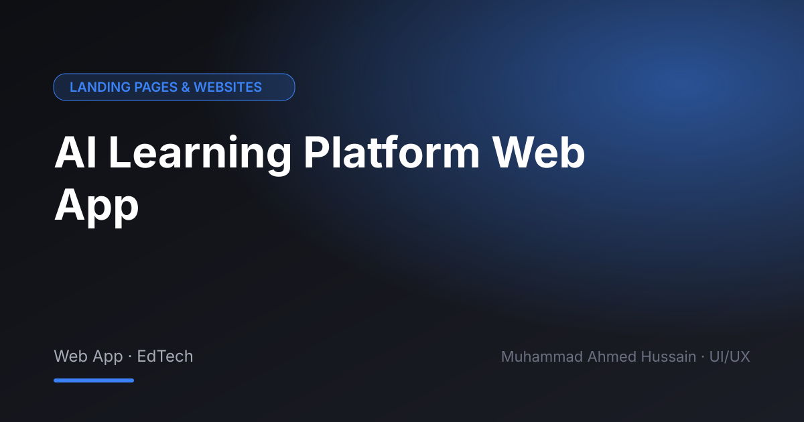

# AI Learning Platform Web App

**Category:** Landing Pages & Websites · **Type:** Web App · EdTech · **Tool:** Figma

An AI-powered learning platform where students follow courses, track progress and get help from an AI tutor.

## The challenge

Learning platforms often feel like a pile of videos. The goal was a clear path through content with progress that motivates.

## What I designed

- Learner dashboard and progress
- Course and lesson pages
- AI assistant / tutor interface
- Onboarding and landing page

## Approach

Structured the product around the learner's next step, with the AI assistant available in context instead of a separate tool.

## Screens

<!-- Add exported screens to the images/ folder, then list them here, e.g.  -->
_Screens are in the [`images`](images/) folder._

## Process

Discovery → wireframes and user flows → high-fidelity UI with a component library → clickable prototype → developer-ready handoff.

---

[← Back to all projects](../../../README.md) · [Hire me on Upwork](https://www.upwork.com/freelancers/~01a964112574c69119)
