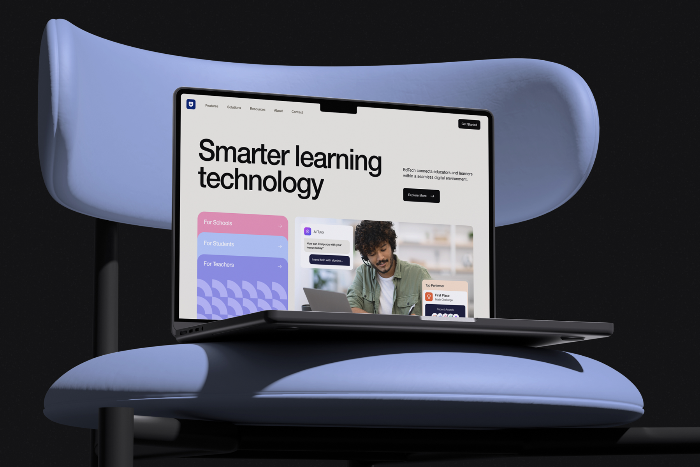
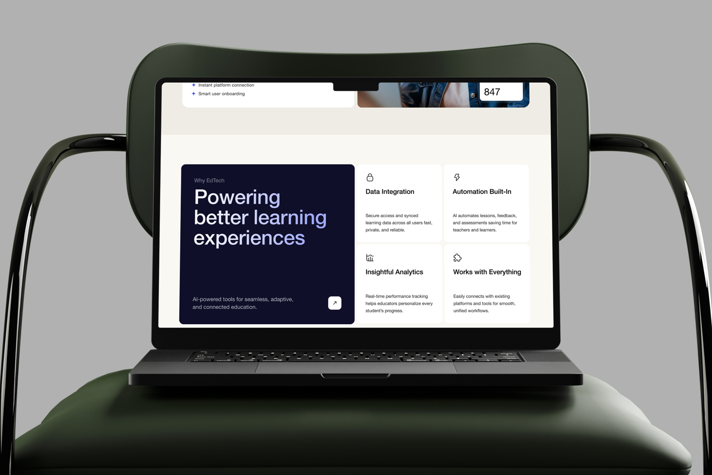

# AI Learning Platform Web App – EdTech UI/UX Design

**Category:** Landing Pages & Websites · **Industry:** EdTech · **Tool:** Figma

EdTech is an AI-powered learning platform that brings schools, teachers and students together in one digital space. I designed the marketing website. It explains the product to three very different audiences and shows the AI tutor in action from the first screen.

## The challenge

An education platform sells to schools, gets used by teachers and has to win over students, and each group wants something different. The site needed to speak to all three without turning into a wall of features, while making "AI" feel helpful and human instead of cold and technical.

## What I designed

- **Hero:** a big, editorial "Smarter learning technology" headline with a short value line ("EdTech connects educators and learners within a seamless digital environment"), an *Explore More* CTA and a *Get Started* button in the nav
- **Audience cards:** stacked *For Schools*, *For Students* and *For Teachers* cards in pink, blue and lilac, so each visitor finds their own path in one click
- **Live product moments:** an *AI Tutor* chat bubble ("How can I help you with your lesson today?" / "I need help with algebra…") and a *Top Performer / First Place – Math Challenge* award card placed over real photography
- **How it works:** "Education Journey" steps, starting with "Students and teachers join through a single smart platform — no manual setup, just instant connection" (instant platform connection, smart user onboarding)
- **Why EdTech:** "Powering better learning experiences" with four benefit cards, *Data Integration*, *Automation Built-In*, *Insightful Analytics* and *Works with Everything*
- **Solutions, testimonials and footer:** "Smart solutions for smarter education", teacher and coordinator quotes, and a product footer (AI Tutor, Learning Dashboard, Progress Tracker, Classroom Analytics)

## Visual style

- **Editorial typography:** oversized, tight-tracked grotesk headlines give the brand confidence
- **Soft, friendly palette:** pink, periwinkle and lilac for audiences, deep navy for emphasis sections, warm off-white backgrounds
- **Geometric patterns** on the audience cards add playfulness without clutter
- **Real people + product UI** together, so the AI feels like it's working for someone

## Approach

- **Segment early.** The three audience cards sit right under the headline, so no one has to scroll to find "is this for me?"
- **Show, don't tell.** The AI tutor and achievement cards show what the product does before the copy explains it.
- **Benefits in plain words.** Each feature card is one idea with a one-sentence explanation.

## Process

Discovery → audience mapping (schools, teachers, students) → wireframes → high-fidelity UI → responsive layouts → developer handoff.

**Tags:** Landing Page Design · Website Design · Web UI/UX · Responsive Web Design · Website Redesign · Conversion-Focused Design · Figma · UI/UX Designer

---

[← Back to all projects](../../../README.md) · [Hire this UI/UX designer on Upwork](https://www.upwork.com/freelancers/~01a964112574c69119)
