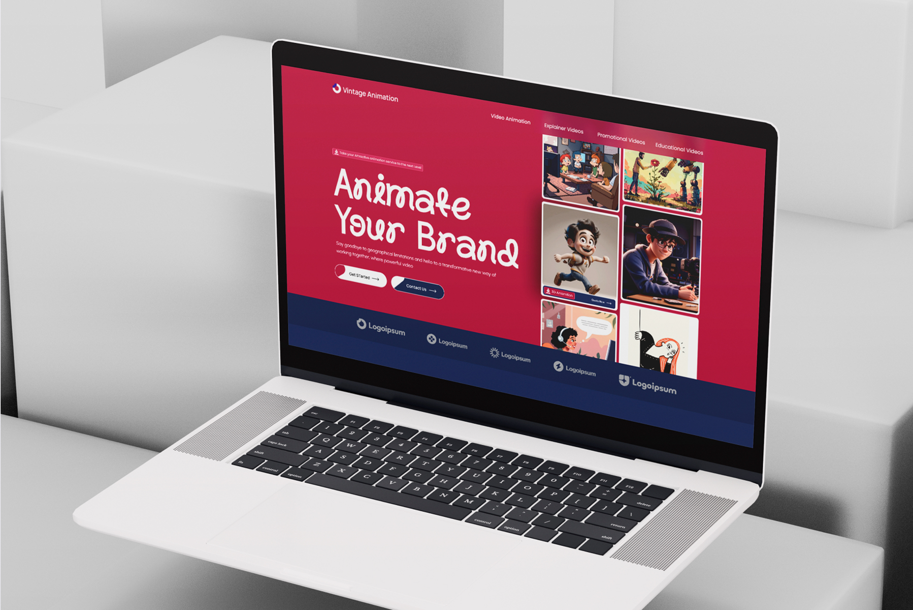
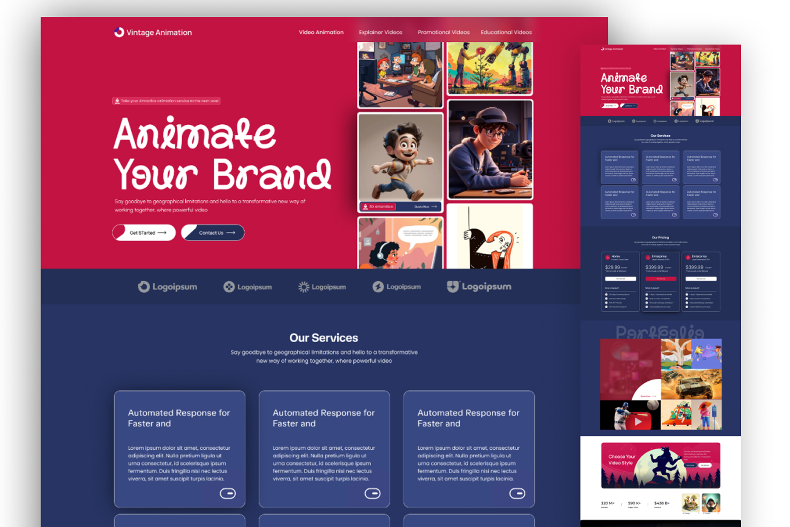

# Vintage Animation – Animation Studio Brand Landing Page Design

**Category:** Landing Pages & Websites · **Industry:** Animation / Video production · **Tool:** Figma

Vintage Animation is an animation studio that turns brands into characters and stories. I designed its landing page: a bold, illustration-led site that shows the studio's range, explains services and pricing, and makes it easy to start a project.

## The challenge

Animation studios sell something visual and emotional, but buyers still need to understand styles, pricing and how to get started. The page had to feel creative and energetic while staying organised enough to turn visitors into leads.

## What I designed

- **Hero:** "Animate Your Brand" in a playful hand-drawn display font on crimson, with **Get Started** and **Contact Us** buttons and a gallery of 2D and 3D character work (with a *3D Animation – Quote Now* tag)
- **Navigation:** Video Animation, Explainer Videos, Promotional Videos and Educational Videos
- **Client logo strip** on deep navy
- **Our Services:** a grid of glassy cards on navy, one per service
- **Our Pricing:** three plan cards (Home, Enterprise) with monthly and annual pricing, a "What's included" list and **Get Started**, with the recommended plan highlighted
- **Portfolio:** a mosaic of animation styles with a video play section and **Quote Now**
- **"Choose Your Video Style":** a style picker with 2D and 3D design examples and a stats strip
- **Get in Touch:** a contact form over an illustrated background
- **Footer:** a big "Let's Animate" script headline, a *Vintage Animation* marquee and product, partner and support links

## Visual style

- **Colour:** crimson red and deep navy, with vivid full-colour illustrations
- **Type:** a playful hand-drawn display font for headlines and a clean geometric sans for content
- **Look:** glassmorphism cards, pill buttons and rounded image tiles

## Approach

- **Show the work in the hero.** Character art sits right next to the headline.
- **Pricing on the page**, so buyers can qualify themselves.
- **Strong contrast:** crimson and white buttons on navy guide the eye to each next step.
- **Two clear paths:** Get Started for ready buyers, Contact Us for questions.

## Process

Discovery → page structure and content → wireframes → high-fidelity UI → responsive layouts → developer handoff.

**Tags:** Landing Page Design · Website Design · Web UI/UX · Responsive Web Design · Website Redesign · Conversion-Focused Design · Figma · UI/UX Designer

---

[← Back to all projects](../../../README.md) · [Hire this UI/UX designer on Upwork](https://www.upwork.com/freelancers/~01a964112574c69119)
