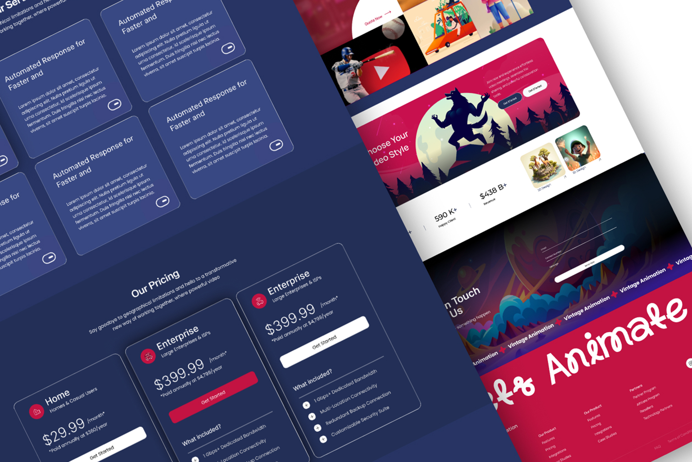

# Animation Studio – Brand Landing Page UI/UX Design

**Category:** Landing Pages & Websites · **Industry:** Animation / Video production · **Tool:** Figma

A landing page for an animation and video studio. It shows off the studio's styles, explains its packages and makes it easy to request a quote. The design balances a bold, playful brand with a clear sales structure.

## The challenge

Animation studios sell something visual and emotional, but buyers still need to understand styles, pricing and how to get started. The page had to feel creative and energetic while staying organised enough to turn visitors into leads.

## What I designed

- **Hero and showcase:** bold illustrated scenes, a video play section and a **Quote Now** action
- **"Choose Your Video Style":** a style picker with 2D and 3D design examples
- **Stats strip:** happy clients and revenue figures for credibility
- **Services grid:** glassy cards on deep navy that explain each service
- **Pricing:** three plan cards with monthly and annual pricing, a "What's included" list and **Get Started** buttons, with the recommended plan highlighted
- **Get in Touch:** a contact form over an illustrated background
- **Footer:** a big "Let's Animate" script headline, a *Vintage Animation* marquee and product, partner and support links

## Visual style

- **Colour:** deep navy with hot crimson accents and vivid illustrations
- **Type:** clean geometric sans for content, with a playful script for the closing headline
- **Look:** glassmorphism cards, rounded sections and full-colour artwork

## Approach

- **Show the work before the pitch.** Illustrations and style examples come first.
- **Pricing on the page** so buyers can qualify themselves.
- **Strong contrast:** crimson buttons on navy guide the eye to each next step.

## Process

Discovery → page structure and content → wireframes → high-fidelity UI → responsive layouts → developer handoff.

**Tags:** Landing Page Design · Website Design · Web UI/UX · Responsive Web Design · Website Redesign · Conversion-Focused Design · Figma · UI/UX Designer

---

[← Back to all projects](../../../README.md) · [Hire this UI/UX designer on Upwork](https://www.upwork.com/freelancers/~01a964112574c69119)
