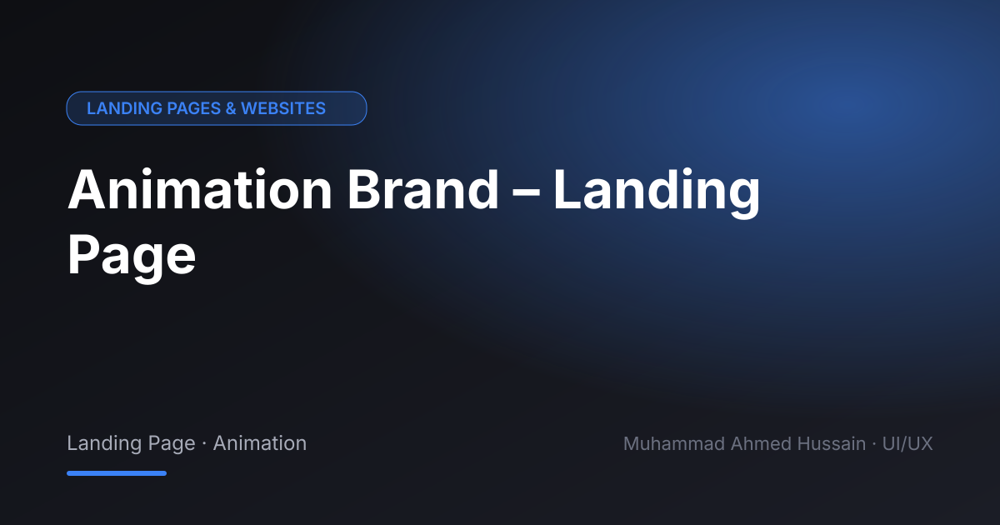

# Animation Brand – Landing Page

**Category:** Landing Pages & Websites · **Type:** Landing Page · Animation · **Tool:** Figma

A brand landing page for an animation service, built around showcasing work and booking a project.

## The challenge

Visitors decide on style in seconds. The page had to show range quickly and make starting a project easy.

## What I designed

- Hero and showreel
- Service packages
- Process steps
- Contact CTA

## Approach

Strong visual hierarchy with portfolio pieces placed before the sales copy.

## Screens

<!-- Add exported screens to the images/ folder, then list them here, e.g.  -->
_Screens are in the [`images`](images/) folder._

## Process

Discovery → wireframes and user flows → high-fidelity UI with a component library → clickable prototype → developer-ready handoff.

---

[← Back to all projects](../../../README.md) · [Hire me on Upwork](https://www.upwork.com/freelancers/~01a964112574c69119)
