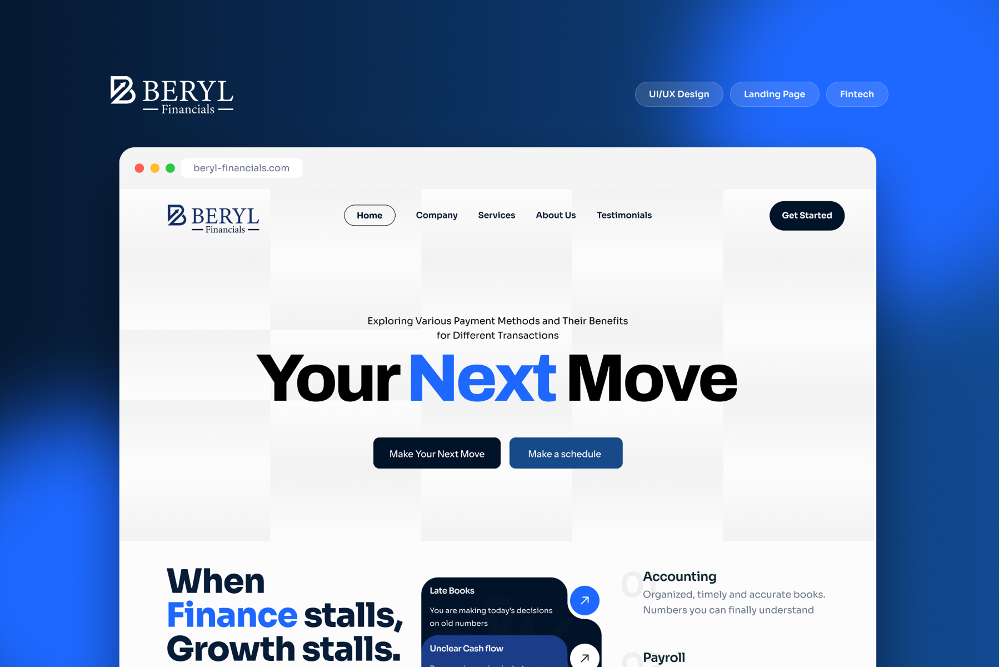
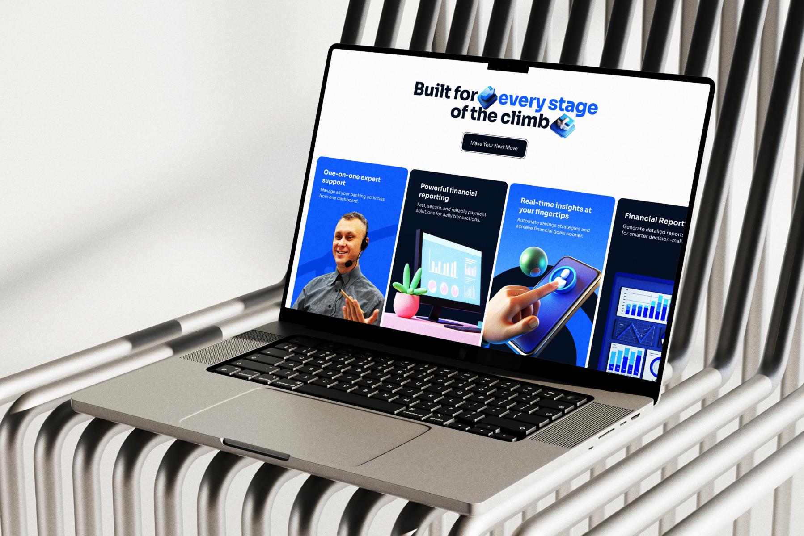
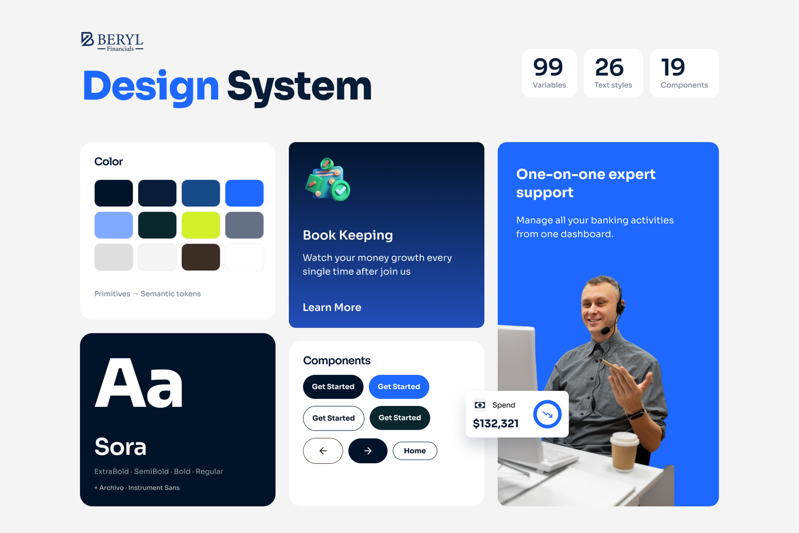

# Beryl Financials – Fintech Landing Page UI/UX Design

**Category:** Landing Pages & Websites · **Industry:** Fintech / Financial services · **Tool:** Figma

Beryl Financials offers accounting, payroll, bookkeeping and financial reporting to growing businesses. I designed their marketing landing page and the design system behind it. The page has one job: turn a visitor who is worried about their numbers into a booked call.

## The challenge

Business owners rarely go looking for an accounting partner when things are calm. They come when the books are late, cash flow is unclear and decisions are being made on old numbers. The page had to name that pain right away, show that Beryl fixes it and make the next step obvious, while looking trustworthy enough for a finance brand.

## What I designed

- **Hero:** a big, bold "Your Next Move" headline with two clear CTAs, *Make Your Next Move* (primary) and *Make a schedule* (secondary), plus a simple top nav (Home, Company, Services, About Us, Testimonials) and a persistent *Get Started* button
- **Problem section:** "When Finance stalls, Growth stalls." Pain-point cards (*Late Books*, *Unclear Cash Flow*) sit next to the services that solve them (*Accounting*, *Payroll*), so each problem lines up with its fix
- **Feature cards:** "Built for every stage of the climb" with cards for *One-on-one expert support*, *Powerful financial reporting*, *Real-time insights at your fingertips* and *Financial Reports*, using real photography and 3D illustration
- **Responsive layouts** for desktop and mobile

## Design system

I built the page on a small, production-ready design system in Figma so developers could build it without guessing.

- **99 variables** set up as primitives → semantic tokens
- **26 text styles**, with **Sora** (ExtraBold, SemiBold, Bold, Regular) as the main typeface and Archivo and Instrument Sans as supporting fonts
- **19 components**, including button variants (primary, accent, outline, dark), navigation arrows, nav pills, service cards and stat chips
- **Colour:** deep navy and electric blue carry trust and energy, with a lime accent kept for highlights

## Approach

- **Problem first, features second.** Visitors see their own situation before they see a sales pitch.
- **One primary action.** "Make Your Next Move" repeats at each decision point, and *Make a schedule* is there for people who are ready to talk.
- **Trust through restraint.** A limited palette, strong type and lots of white space keep the brand feeling credible, and the human photography in the support card makes it feel personal.
- **Built to hand off.** Tokens, text styles and components mean every section is consistent and quick to develop.

## Process

Discovery → wireframes and content structure → high-fidelity UI → design system (tokens, type, components) → responsive layouts → developer handoff.

**Tags:** Landing Page Design · Website Design · Web UI/UX · Responsive Web Design · Website Redesign · Conversion-Focused Design · Figma · UI/UX Designer

---

[← Back to all projects](../../../README.md) · [Hire this UI/UX designer on Upwork](https://www.upwork.com/freelancers/~01a964112574c69119)
