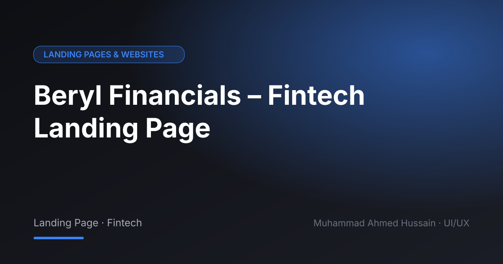

# Beryl Financials – Fintech Landing Page

**Category:** Landing Pages & Websites · **Type:** Landing Page · Fintech · **Tool:** Figma

A conversion-focused landing page for a financial services brand that needed to look trustworthy from the first scroll.

## The challenge

Finance visitors are cautious. The page had to build trust fast and lead to one clear call to action.

## What I designed

- Hero with value proposition and CTA
- Services and features sections
- Trust signals and testimonials area
- Responsive desktop and mobile layouts

## Approach

Clean layout, strong typography and a restrained palette, with the CTA repeated at natural decision points.

## Screens

<!-- Add exported screens to the images/ folder, then list them here, e.g.  -->
_Screens are in the [`images`](images/) folder._

## Process

Discovery → wireframes and user flows → high-fidelity UI with a component library → clickable prototype → developer-ready handoff.

---

[← Back to all projects](../../../README.md) · [Hire me on Upwork](https://www.upwork.com/freelancers/~01a964112574c69119)
