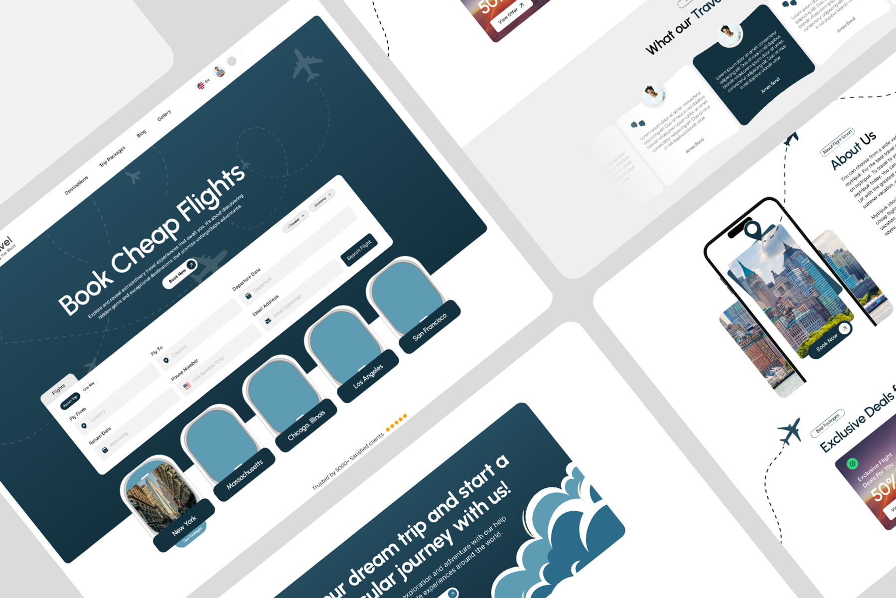
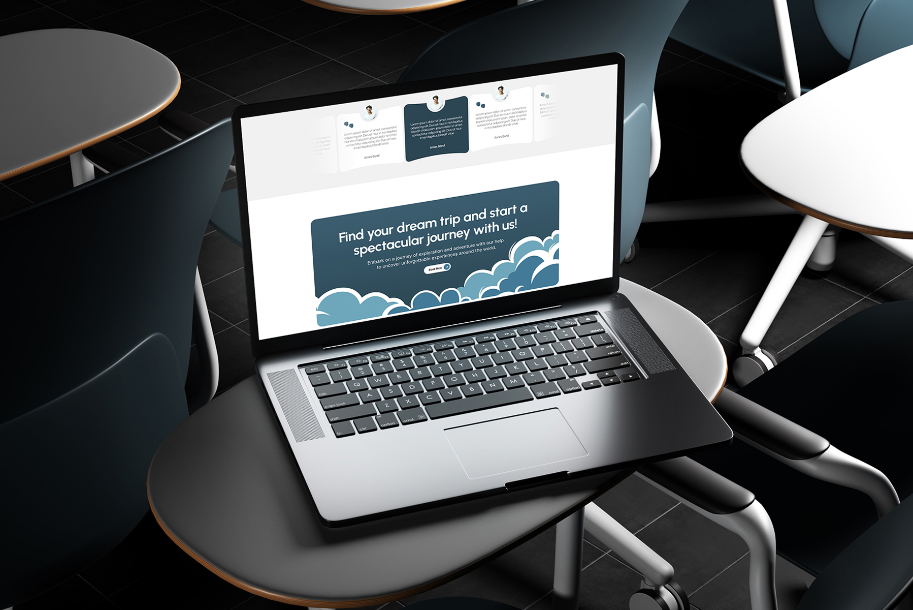
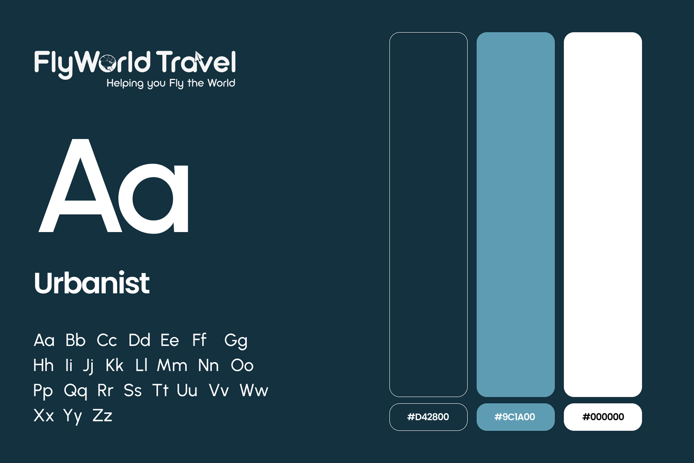

# FlyWorld Travel – Flight Booking Website & Landing Page Design

**Category:** Landing Pages & Websites · **Industry:** Travel / Flight booking · **Tool:** Figma

FlyWorld Travel ("Helping you Fly the World") sells cheap flights and trip packages. I designed their landing page around one job: get visitors searching for a flight, and capture their details so the sales team can follow up with the best fare.

## The challenge

Travel sites are noisy, full of banners, deals and pop-ups. FlyWorld needed a page that's calm, trustworthy and focused, with the flight search form right in the hero. It also needed enough inspiration (destinations, deals, reviews) to keep undecided travellers on the page.

## What I designed

- **Hero:** "Book Cheap Flights" with a short value line and a **Book Now** button over a navy sky with dotted flight paths
- **Flight search form:** Round-trip / One-way, Fly From and Fly To, departure and return dates, travellers, cabin class, phone number (US numbers) and optional email, plus **Search Flight**
- **Destination cards** shaped like airplane windows (New York, Massachusetts, Chicago, Los Angeles, San Francisco)
- **Social proof:** "Trusted by 5000+ satisfied clients" with star ratings and a testimonials section
- **Exclusive Deals:** flight deal cards (up to 50% off)
- **About Us** with a phone-mockup city visual, and a closing CTA: "Start your dream trip and a spectacular journey with us!"
- **Navigation:** Destinations, Trip Packages, Blog, Gallery and a language switcher

## Visual style

- **Logo:** a FlyWorld Travel wordmark with a globe and plane, plus the tagline "Helping you Fly the World"
- **Type:** Urbanist
- **Colour:** deep navy, steel blue and white, a calm, trustworthy "sky" palette

## Approach

- **Search is the hero.** The form sits above the fold with every field visible.
- **Memorable details.** Airplane-window destination cards and dotted flight paths make the brand stand out.
- **Lead capture built in.** Phone and email fields let the team follow up with fares.
- **Proof near the action:** satisfied-client counts and ratings sit right under the search.

## Process

Discovery → booking and lead-capture flow → wireframes → brand style → high-fidelity UI → responsive layouts → developer handoff.

**Tags:** Landing Page Design · Website Design · Web UI/UX · Responsive Web Design · Website Redesign · Conversion-Focused Design · Figma · UI/UX Designer

---

[← Back to all projects](../../../README.md) · [Hire this UI/UX designer on Upwork](https://www.upwork.com/freelancers/~01a964112574c69119)
