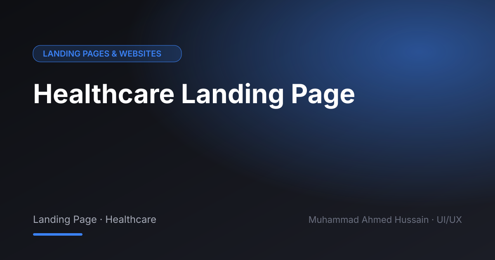

# Healthcare Landing Page

**Category:** Landing Pages & Websites · **Type:** Landing Page · Healthcare · **Tool:** Figma

A healthcare website designed to feel calm and credible, with an easy route to booking care.

## The challenge

Patients look for trust and clarity. The page needed to explain services simply and make booking obvious.

## What I designed

- Hero with booking CTA
- Services and specialists
- Patient testimonials area
- Contact and locations

## Approach

Soft palette, plenty of white space and a booking action visible throughout.

## Screens

<!-- Add exported screens to the images/ folder, then list them here, e.g.  -->
_Screens are in the [`images`](images/) folder._

## Figma file

[Open the design in Figma](https://www.figma.com/design/QQbCbXCyTqc6pSvquRcw14/Healthcare-Landing-Page?node-id=413-1660)

## Process

Discovery → wireframes and user flows → high-fidelity UI with a component library → clickable prototype → developer-ready handoff.

**Tags:** Landing Page Design · Website Design · Web UI/UX · Responsive Web Design · Website Redesign · Conversion-Focused Design · Figma · UI/UX Designer

---

[← Back to all projects](../../../README.md) · [Hire this UI/UX designer on Upwork](https://www.upwork.com/freelancers/~01a964112574c69119)
