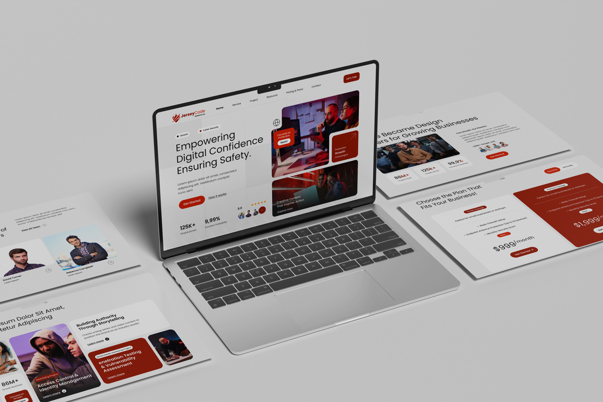
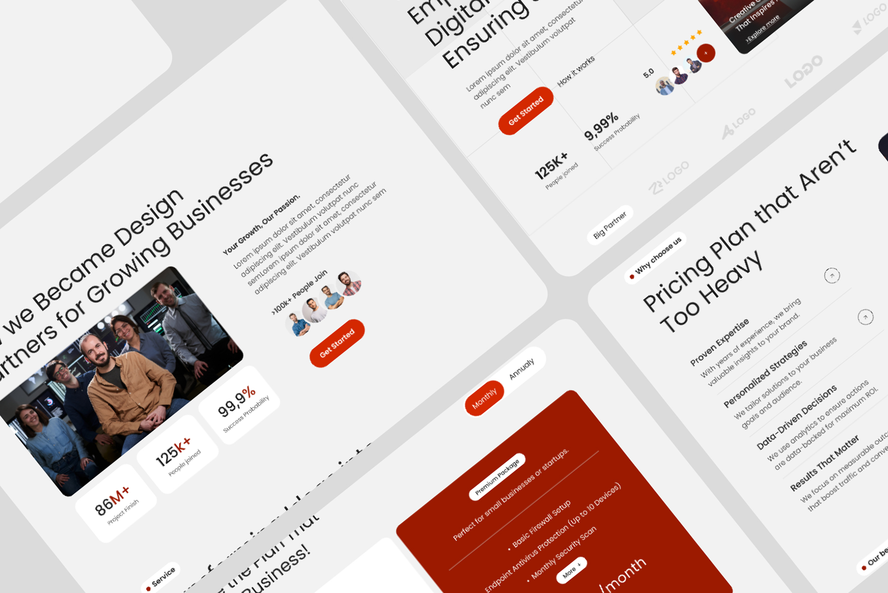
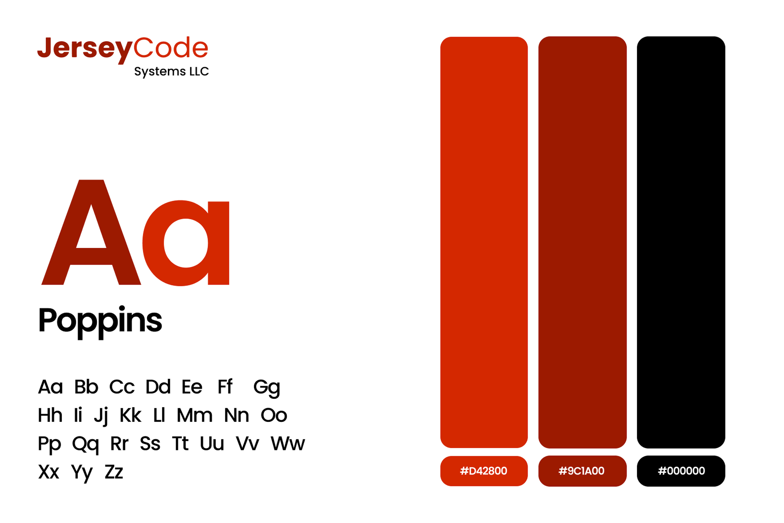

# JerseyCode Systems – Cybersecurity Company Website & Landing Page Design

**Category:** Landing Pages & Websites · **Industry:** Cybersecurity / IT services · **Tool:** Figma

JerseyCode Systems LLC is a cybersecurity and digital growth company. I designed their website: a confident, modern landing page that explains their services, builds trust and turns visitors into sales calls.

## The challenge

Security companies have to feel trustworthy, but most cybersecurity sites are dark, technical and intimidating. JerseyCode wanted the opposite: a bright, human, professional site that still says "we take protection seriously", with clear services, proof and pricing.

## What I designed

- **Hero:** "Empowering Digital Confidence, Ensuring Safety." with *Growth* and *Cyber Security* tags, **Get Started** and *How it works* actions, trust stats (125K+ people joined, success rate, 5.0 rating with client avatars) and a collage of image cards (*Focused on Protection*, *Protection Growth Campaigns*, *Creative Content That Inspires Action*)
- **Navigation:** Home, Service, Project, Resource, Pricing & Plans, Contact, plus a **Let's Talk** button
- **About:** "We Became Design Partners for Growing Businesses", with a team photo and stat cards (86M+ projects finished)
- **Partner logos** and a **Why choose us** section (Proven Expertise, Personalized Strategies, Data-Driven Decisions, Results That Matter)
- **Projects:** case cards such as *Access Control & Identity Management* and *Penetration Testing & Vulnerability Assessment*
- **Pricing:** "Choose the Plan That Fits Your Business!", with a Monthly / Annually toggle and Growth and Premium packages
- **Team** section with member cards

## Visual style

- **Type:** Poppins
- **Colour:** signal red `#D42800`, deep red `#9C1A00` and black `#000000` on soft light-grey backgrounds
- **Look:** rounded cards, real team photography and red used for actions and highlights

## Approach

- **Trust before features.** Stats, ratings and partner logos appear right in and below the hero.
- **Human, not hacker.** Real people and a light layout make security feel approachable.
- **One clear action per section** (Get Started, Let's Talk), all in the same red.
- **Pricing on the page**, so buyers can qualify themselves before a call.

## Process

Discovery → content structure and sitemap → wireframes → high-fidelity UI → responsive layouts → developer handoff.

## Figma file

[Open the design in Figma](https://www.figma.com/design/3sbfOy1vSqRjb12G7qBtiI/JERSEYCODE-UI?node-id=0-1)

**Tags:** Landing Page Design · Website Design · Web UI/UX · Responsive Web Design · Website Redesign · Conversion-Focused Design · Figma · UI/UX Designer

---

[← Back to all projects](../../../README.md) · [Hire this UI/UX designer on Upwork](https://www.upwork.com/freelancers/~01a964112574c69119)
