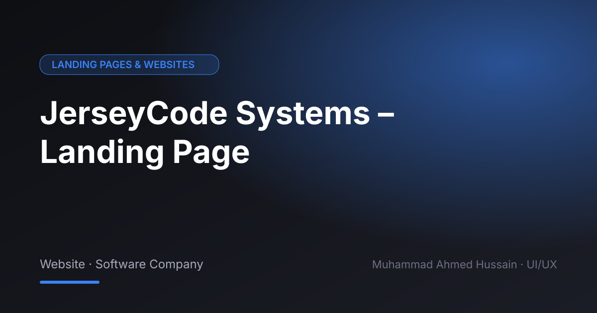

# JerseyCode Systems – Landing Page

**Category:** Landing Pages & Websites · **Type:** Website · Software Company · **Tool:** Figma

A website for a software development company, presenting services, process and work in a modern tech style.

## The challenge

Tech agencies all sound the same. The site needed a clear structure that explains what they do and why to pick them.

## What I designed

- Hero and services
- Process and tech stack
- Case studies section
- Contact and lead form

## Approach

Bold dark UI with clear sections and a single path to the contact form.

## Screens

<!-- Add exported screens to the images/ folder, then list them here, e.g.  -->
_Screens are in the [`images`](images/) folder._

## Figma file

[Open the design in Figma](https://www.figma.com/design/3sbfOy1vSqRjb12G7qBtiI/JERSEYCODE-UI?node-id=0-1)

## Process

Discovery → wireframes and user flows → high-fidelity UI with a component library → clickable prototype → developer-ready handoff.

---

[← Back to all projects](../../../README.md) · [Hire me on Upwork](https://www.upwork.com/freelancers/~01a964112574c69119)
