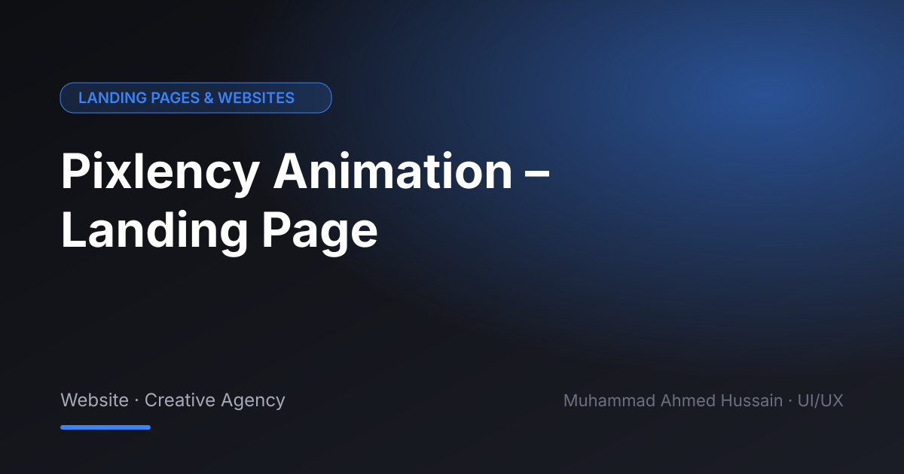

# Pixlency Animation – Landing Page

**Category:** Landing Pages & Websites · **Type:** Website · Creative Agency · **Tool:** Figma

A landing page for an animation studio that lets the work speak first.

## The challenge

Creative studios need personality without hiding the portfolio. The page had to feel playful and still convert.

## What I designed

- Showreel hero
- Services (2D, 3D, motion)
- Portfolio grid
- Pricing / contact

## Approach

Visual-first layout, expressive type and space for motion previews.

## Screens

<!-- Add exported screens to the images/ folder, then list them here, e.g.  -->
_Screens are in the [`images`](images/) folder._

## Figma file

[Open the design in Figma](https://www.figma.com/design/XWgjAmfqMC4yjoHNg0ky3w/Pixlency-Animation?node-id=0-1)

## Process

Discovery → wireframes and user flows → high-fidelity UI with a component library → clickable prototype → developer-ready handoff.

**Tags:** Landing Page Design · Website Design · Web UI/UX · Responsive Web Design · Website Redesign · Conversion-Focused Design · Figma · UI/UX Designer

---

[← Back to all projects](../../../README.md) · [Hire this UI/UX designer on Upwork](https://www.upwork.com/freelancers/~01a964112574c69119)
