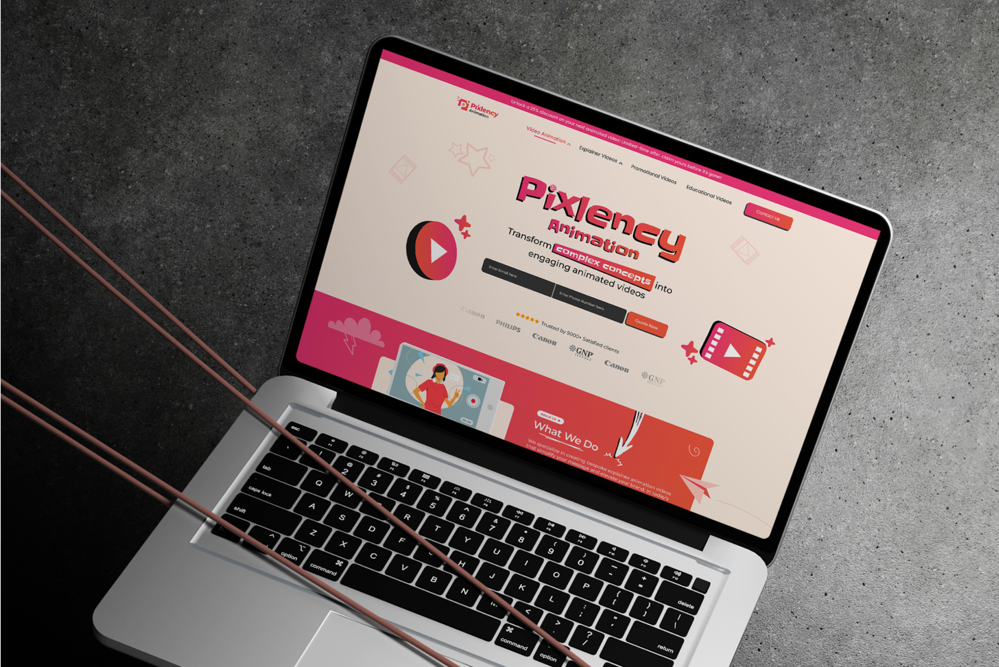
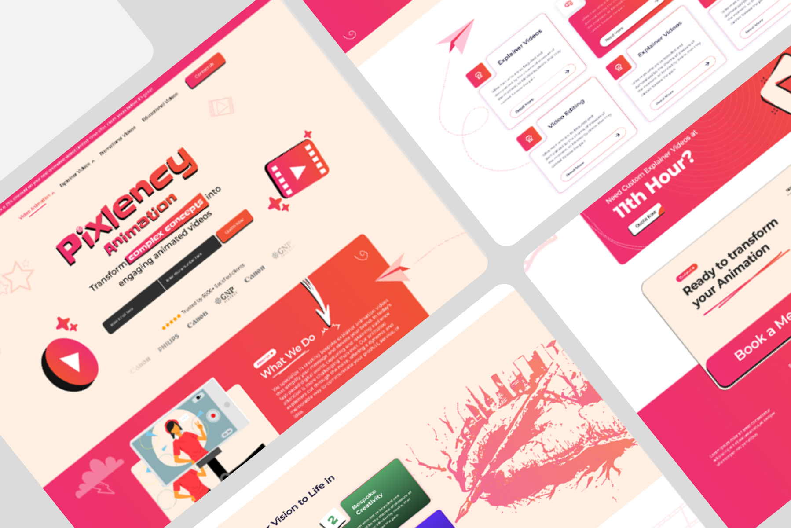
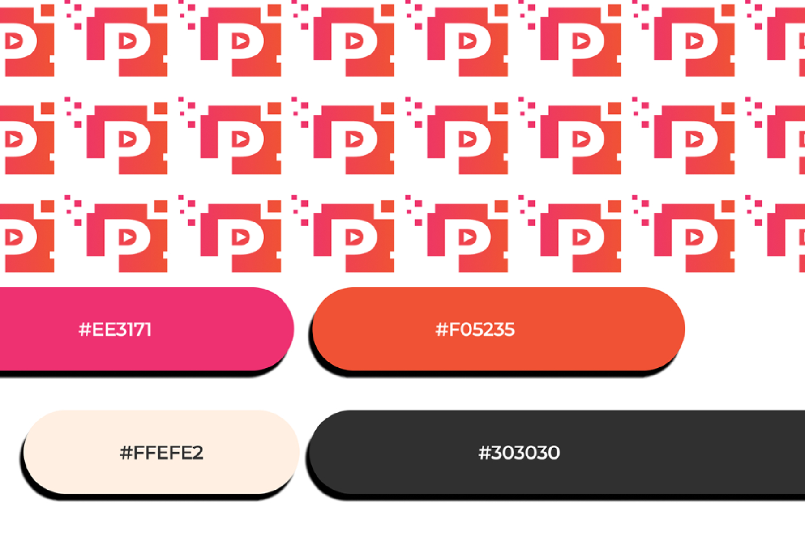

# Pixlency Animation – Explainer Video Studio Landing Page Design

**Category:** Landing Pages & Websites · **Industry:** Animation / Explainer videos · **Tool:** Figma

Pixlency Animation is a studio that makes explainer, promotional and educational animated videos. I designed their lead-generation landing page. It's playful enough to show the studio's personality and focused enough to turn visitors into quote requests.

## The challenge

Animation studios compete on creativity, but buyers usually land on the page with one question: *Can you make my product easy to understand, and fast?* The page needed to show style instantly, prove trust and capture contact details above the fold.

## What I designed

- **Promo bar:** "Unlock a 25% discount on your next animated video – limited-time offer"
- **Navigation:** Video Animation, Explainer Videos, Promotional Videos and Educational Videos dropdowns, plus **Contact Us**
- **Hero:** a bold sticker-style "Pixlency Animation" logotype, the headline "Transform **complex concepts** into engaging animated videos", and an inline lead form (email + phone + **Quote Now**)
- **Trust strip:** "Trusted by 5000+ satisfied clients" with star ratings and client logos
- **What We Do:** an illustrated about section explaining bespoke explainer videos
- **Services:** cards for Explainer Videos, Video Editing and more, each with a *Read More* link
- **Urgency CTA:** "Need custom explainer videos at the 11th hour?" with **Quote Now**
- **Process:** "Bring your vision to life in…" numbered steps (e.g. Bespoke Creativity)
- **Closing CTA:** "Ready to transform your animation?" with **Book a Meeting**

## Brand style

- **Logo:** a pixel-built "p" with a play button, repeated as a brand pattern
- **Colour:** hot pink `#EE3171`, coral orange `#F05235`, warm cream `#FFEFE2` and charcoal `#303030`
- **Look:** chunky sticker shadows, hand-drawn arrows, paper planes and playful illustrations

## Approach

- **Capture leads in the hero.** Email, phone and Quote Now are visible before any scrolling.
- **Personality that sells.** Sticker-style type and illustrations show the studio's craft right away.
- **Repeated CTAs at decision points:** hero, urgency banner and the closing Book a Meeting.
- **Social proof up front** with client logos and the 5000+ clients line.

## Process

Discovery → offer and lead-flow mapping → wireframes → brand style → high-fidelity UI → responsive layouts → developer handoff.

## Figma file

[Open the design in Figma](https://www.figma.com/design/XWgjAmfqMC4yjoHNg0ky3w/Pixlency-Animation?node-id=0-1)

**Tags:** Landing Page Design · Website Design · Web UI/UX · Responsive Web Design · Website Redesign · Conversion-Focused Design · Figma · UI/UX Designer

---

[← Back to all projects](../../../README.md) · [Hire this UI/UX designer on Upwork](https://www.upwork.com/freelancers/~01a964112574c69119)
