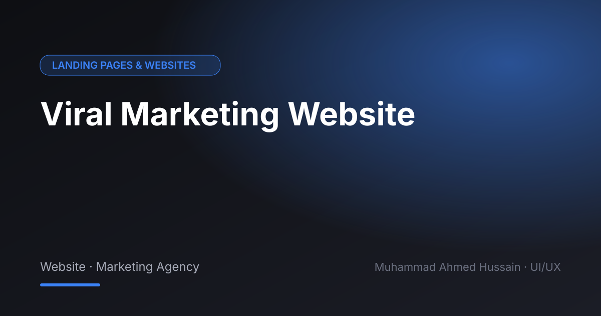

# Viral Marketing Website

**Category:** Landing Pages & Websites · **Type:** Website · Marketing Agency · **Tool:** Figma

A website for a digital marketing agency that sells growth, so the site itself had to feel energetic and results-led.

## The challenge

Marketing agencies need to prove they get results. The layout had to put services and outcomes up front.

## What I designed

- Hero and services
- Results / case study section
- Pricing packages
- Contact form

## Approach

Bold colour, short punchy sections and repeated calls to action.

## Screens

<!-- Add exported screens to the images/ folder, then list them here, e.g.  -->
_Screens are in the [`images`](images/) folder._

## Process

Discovery → wireframes and user flows → high-fidelity UI with a component library → clickable prototype → developer-ready handoff.

**Tags:** Landing Page Design · Website Design · Web UI/UX · Responsive Web Design · Website Redesign · Conversion-Focused Design · Figma · UI/UX Designer

---

[← Back to all projects](../../../README.md) · [Hire this UI/UX designer on Upwork](https://www.upwork.com/freelancers/~01a964112574c69119)
